<p align="center">
  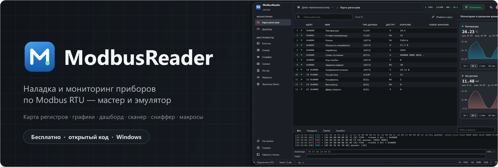
</p>

<p align="center">
  <a href="https://github.com/Mercurrial/ModbusReader/releases/latest"></a>
  <a href="https://github.com/Mercurrial/ModbusReader/releases"></a>
  
  
  <a href="LICENSE"></a>
</p>

<p align="center">
  <a href="https://github.com/Mercurrial/ModbusReader/releases/latest/download/ModbusReader-Setup.exe"></a>
</p>

<p align="center">
  <a href="#возможности">Возможности</a> ·
  <a href="#установка">Установка</a> ·
  <a href="#быстрый-старт">Быстрый старт</a> ·
  <a href="https://modbusreader.ru/">Документация</a> ·
  <a href="#для-разработчиков">Для разработчиков</a> ·
  <a href="#поддержать-проект">Поддержать</a>
</p>

**ModbusReader** — настольная программа для наладки и мониторинга приборов по
протоколам **Modbus RTU** (RS-485) и **Modbus TCP** — в том числе за
преобразователями RS-485 ↔ Ethernet в режиме «RTU по TCP». Она показывает все регистры прибора с именами, единицами
измерения и подписями значений, строит графики в реальном времени, позволяет
собрать пульт из виджетов, автоматизировать проверки макросами и прослушивать
линию сниффером. Если прибора под рукой нет, программа может сама выступить в
роли прибора.

Программа бесплатна, распространяется с открытым исходным кодом, имеет
русский и английский интерфейс и обновляется сама — новая версия ставится в
фоне, перезапуск занимает пару секунд. Это бесплатная альтернатива Modbus Poll и Modbus Slave: мастер,
эмулятор прибора и сниффер RS-485 в одной программе. Руководство, основы
Modbus и примеры — на сайте
**[modbusreader.ru](https://modbusreader.ru/)**.

> **In English:** ModbusReader is a free, open-source **Modbus RTU and Modbus
> TCP master and slave simulator for Windows** — read and write registers over
> RS-485 or Ethernet, live trends, an HMI-style dashboard, a scanner, a sniffer
> and Python macros. A free alternative to Modbus Poll / Modbus Slave, with an
> English UI.
> [Documentation](https://modbusreader.ru/en/) ·
> [Download](https://github.com/Mercurrial/ModbusReader/releases/latest/download/ModbusReader-Setup.exe)

<p align="center">
  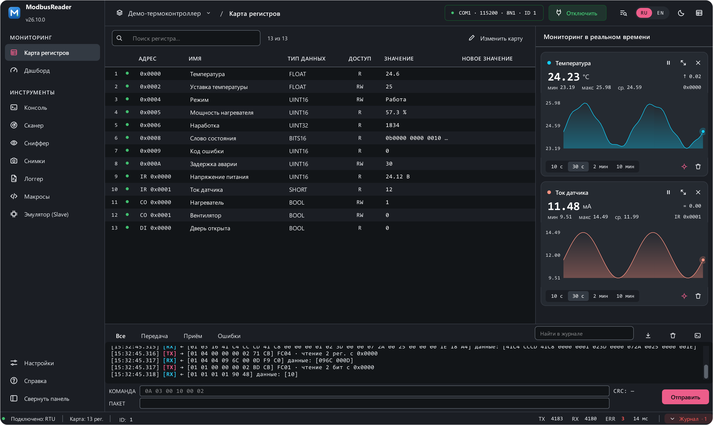
</p>
<p align="center"><sub>Демо-проект «термоконтроллер»: значения с единицами и перечислениями, живые графики, журнал обмена с разбором каждого кадра</sub></p>

## Возможности

### Карта регистров

Все регистры прибора в одной таблице — с именами, единицами и состоянием
каждого. Значения обновляются при каждом цикле опроса; запись — в поле
«Новое значение».

- **24 типа данных:** SHORT, UINT16, LONG, UINT32, FLOAT, DOUBLE, INT64, BCD,
  битовые слова, строки, BOOL…; порядок байт настраивается для каждого типа.
- **Все четыре области Modbus:** holding- и input-регистры, coils и discrete
  inputs (чтение FC 01–04, запись FC 05 и 06; эмулятор принимает ещё 15 и 16).
- **Масштаб и перечисления:** «573 → 57.3 %», «1 → Работа» — в таблице,
  графиках, дашборде и логгере.
- **Статистика линии** в углу окна: запросы, ответы, таймауты, ошибки CRC,
  время ответа.

<table>
  <tr>
    <td width="52%" valign="middle">
      <h3>Графики в реальном времени</h3>
      Любой регистр — на график одним щелчком. Крупное текущее значение,
      изменение за окно, мин / макс / среднее, окна 10 с · 30 с · 2 мин · 10 мин.
      Если связь пропала, линия гаснет и показывает, сколько данных нет.
    </td>
    <td width="48%" align="center">
      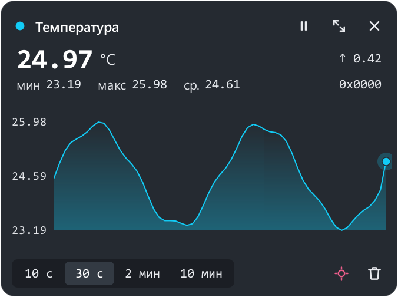
    </td>
  </tr>
</table>

### Дашборд

<p align="center">
  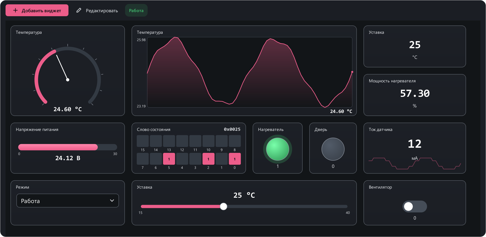
</p>

14 видов виджетов: значения, стрелочные приборы, полосы, лампы, битовые слова,
графики, кнопки, тумблеры, ползунки, списки, поля ввода, таймеры, условия и
надписи. Виджеты расставляются свободно, с выравниванием по соседям, а
**провода** между ними дают простую автоматику: «таймер → кнопка → запись в
прибор», а «условие» пропускает импульс, только когда значение, например, выше
порога. Несколько экранов в одном проекте.

### Инструменты

<table>
  <tr>
    <td width="50%" valign="top">
      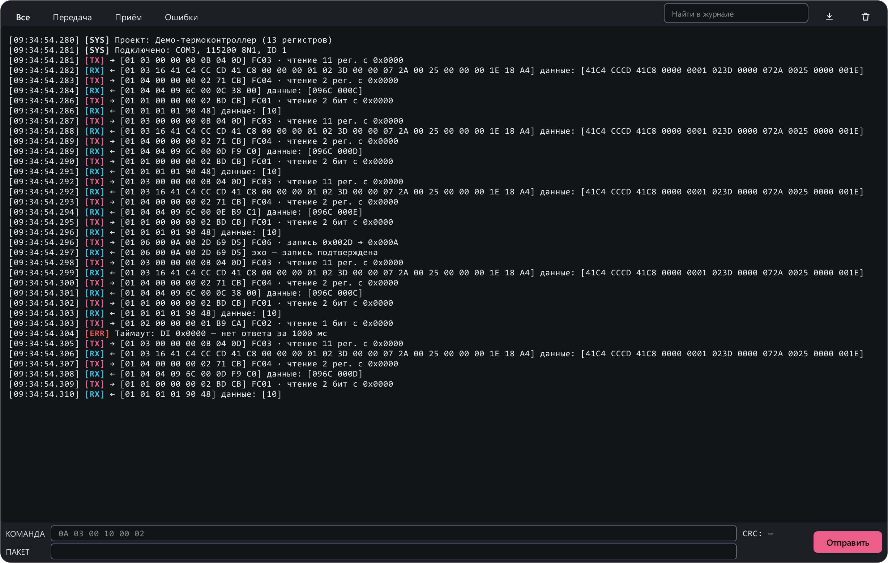<br>
      <b>Консоль.</b> Журнал обмена с разбором каждого кадра и отправка
      сырых кадров — CRC16 или заголовок MBAP добавляются сами.
    </td>
    <td width="50%" valign="top">
      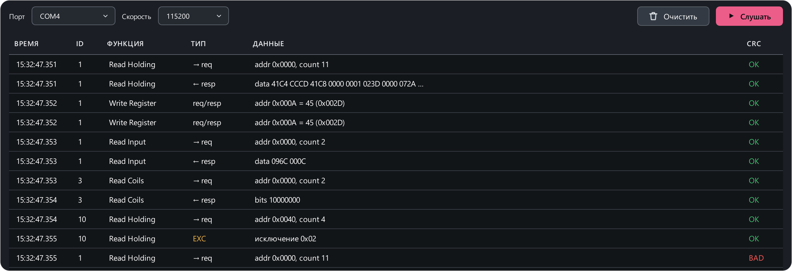<br>
      <b>Сниффер.</b> Слушает линию через второй адаптер, не передавая ни
      байта: кто кого спросил, что ответил, где сбой CRC.
    </td>
  </tr>
  <tr>
    <td width="50%" valign="top">
      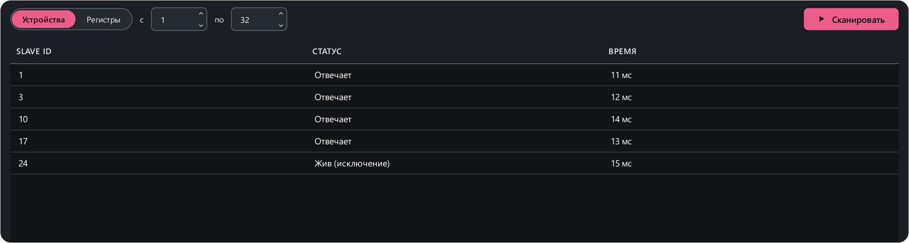<br>
      <b>Сканер.</b> Находит приборы на линии по адресам, живые регистры
      на одном приборе и приборы Modbus TCP в сети.
    </td>
    <td width="50%" valign="top">
      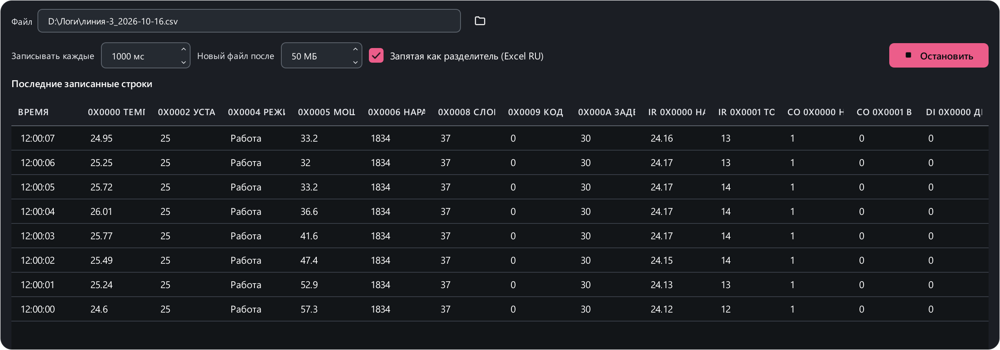<br>
      <b>Логгер.</b> Многочасовая запись в CSV, который сразу открывается в
      Excel; новый файл по достижении размера.
    </td>
  </tr>
  <tr>
    <td width="50%" valign="top">
      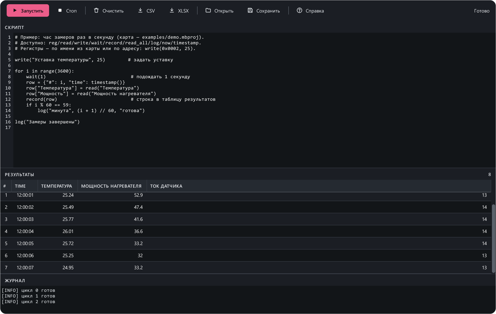<br>
      <b>Макросы.</b> Скрипты на Python: читают и пишут регистры по именам,
      собирают таблицу результатов, сохраняют её в CSV / Excel.
    </td>
    <td width="50%" valign="top">
      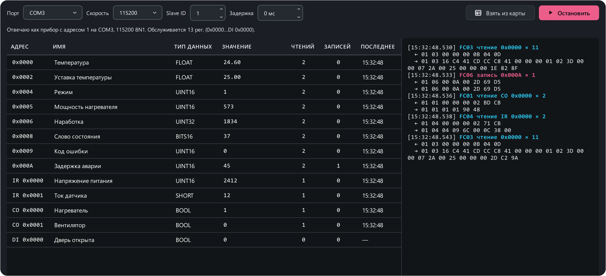<br>
      <b>Эмулятор (Slave).</b> Программа отвечает мастеру как прибор — по
      открытой карте, через COM-порт или по Modbus TCP — для проверки SCADA
      или контроллера без реального прибора.
    </td>
  </tr>
  <tr>
    <td width="50%" valign="top">
      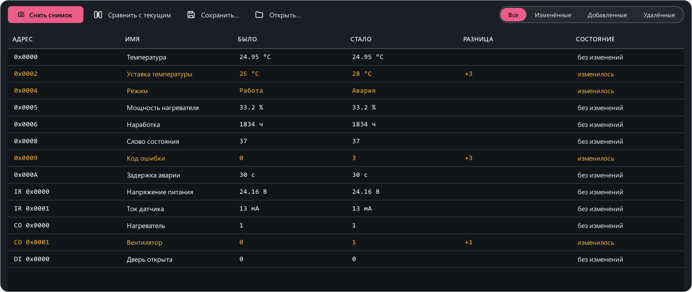<br>
      <b>Снимки.</b> «Что изменилось?» — снимок всех значений и сравнение
      с текущими, с разницей.
    </td>
    <td width="50%" valign="top">
      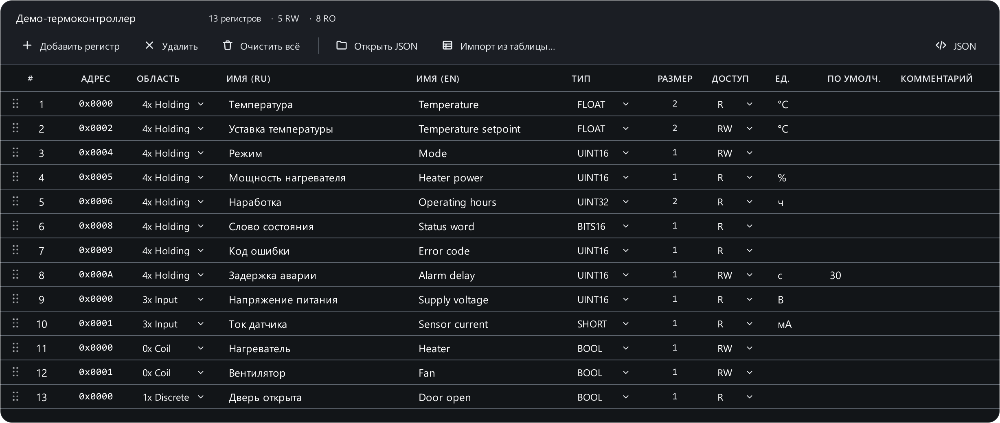<br>
      <b>Редактор карты.</b> Карта регистров с нуля или импорт из CSV / Excel;
      перетаскивание строк, отмена и повтор.
    </td>
  </tr>
  <tr>
    <td width="50%" valign="top">
      <p align="center">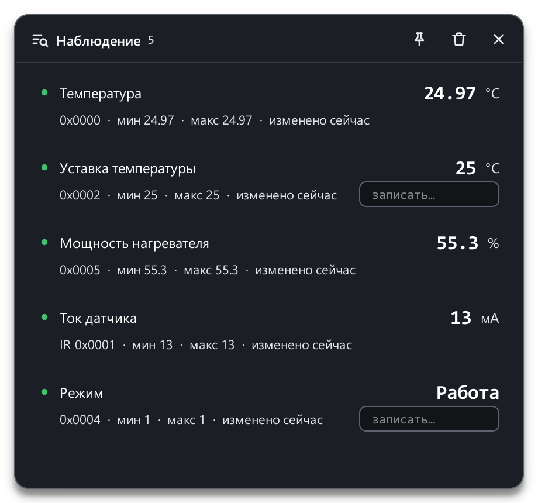</p>
      <b>Наблюдение (F6).</b> Плавающее окно с выбранными регистрами — видно
      с любого экрана, можно закрепить поверх всех окон.
    </td>
    <td width="50%" valign="top">
      <p align="center">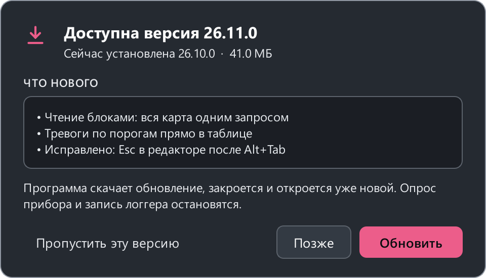</p>
      <b>Обновления.</b> Новая версия ставится в фоне, пока вы работаете;
      «Обновить до …» в меню — и через пару секунд вы в ней.
    </td>
  </tr>
</table>

### Оформление

<p align="center">
  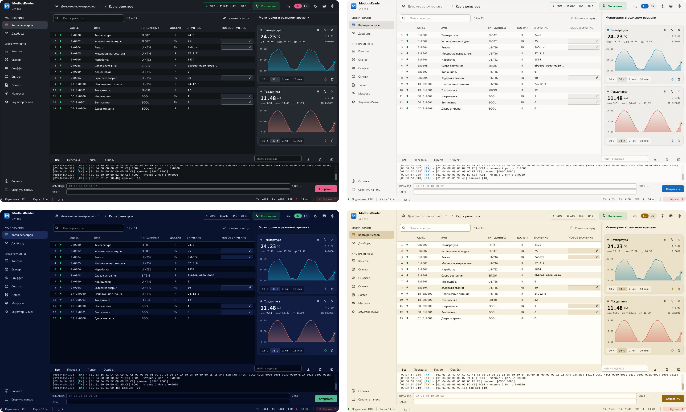
</p>

Тёмная и светлая темы, 7 цветовых схем, 12 акцентов, 3 уровня контраста,
выбор шрифта и его размера, меню слева, справа или сверху — с живым
предпросмотром прямо в окне. При первом запуске главное из этого предлагает
выбрать карточка «Добро пожаловать».

## Установка

Установщик всегда лежит по одной и той же ссылке —
**[ModbusReader-Setup.exe](https://github.com/Mercurrial/ModbusReader/releases/latest/download/ModbusReader-Setup.exe)**; портативная версия — на странице
**[Releases](https://github.com/Mercurrial/ModbusReader/releases/latest)**.
Установленная программа сразу после запуска проверяет, нет ли версии новее,
и ставит её в фоне.

**Что нужно на компьютере:** Windows 10 (версия 1809 и новее) или Windows 11,
64-битная. Python и все библиотеки уже внутри — ничего дополнительно ставить
не нужно. Для работы с прибором — USB-адаптер RS-485 (его драйвер ставится
отдельно, от производителя адаптера) или сеть для Modbus TCP; интернет нужен
только для обновлений.

| | Установщик | Портативная версия |
|---|:---:|:---:|
| Файл | `ModbusReader-Setup.exe` | `ModbusReader.exe` |
| Куда | только для себя (по умолчанию) или для всех — в `C:\Program Files` | любая папка |
| Права администратора | только для себя — нет, для всех пользователей — да | не нужны |
| Ярлыки в «Пуске» и на рабочем столе | ✓ | — |
| `.mbproj` открывается двойным щелчком | ✓ | — |
| Удаление | через «Приложения» | удалением файла |
| Где настройки | `%APPDATA%\ModbusReader` | рядом с exe |
| Автообновление | ✓ | ✓ |

> **Windows может предупредить** «Система Windows защитила ваш компьютер» —
> программа пока не подписана платным сертификатом. Нажмите
> **«Подробнее» → «Выполнить в любом случае»**. Это нужно только при первой
> установке: обновления программа скачивает сама.

### Linux и macOS

Сборки лежат на той же странице
**[Releases](https://github.com/Mercurrial/ModbusReader/releases/latest)**. О
новой версии программа сообщает сама и открывает страницу выпуска; скачивать
её нужно вручную.

**Linux** — `ModbusReader-x86_64.AppImage`, один файл, 64-битная система с
glibc 2.35 и новее (Ubuntu 22.04+, Debian 12+, Fedora 36+ и т. п.):

```bash
chmod +x ModbusReader-x86_64.AppImage && ./ModbusReader-x86_64.AppImage
```

Чтобы программа видела последовательные порты (`/dev/ttyUSB0`, `/dev/ttyACM0`),
пользователь должен состоять в группе `dialout` — один раз, затем перезайти в
систему:

```bash
sudo usermod -aG dialout $USER
```

Если при запуске Qt пишет про платформу `xcb`, не хватает пакета
`libxcb-cursor0` (Debian/Ubuntu) или `xcb-util-cursor` (Fedora, Arch).
Настройки хранятся в `~/.config/ModbusReader`.

**macOS** — `ModbusReader-macOS-arm64.zip`, компьютеры на Apple Silicon (M1 и
новее), macOS 12+. Распакуйте и перенесите `ModbusReader.app` в «Программы».
Сборка не заверена Apple (это платно), поэтому первый запуск macOS
заблокирует: откройте **«Системные настройки» → «Конфиденциальность и
безопасность»** и нажмите **«Всё равно открыть»**. Если macOS пишет, что
программа «повреждена», снимите карантин:

```bash
xattr -dr com.apple.quarantine /Applications/ModbusReader.app
```

Порты адаптеров выглядят как `/dev/cu.usbserial-…`. Настройки хранятся в
`~/Library/Application Support/ModbusReader`.

## Быстрый старт

1. **Установите и запустите.** При первом запуске сразу откроется
   **демо-проект** — термоконтроллер с картой регистров и готовым пультом, —
   а карточка «Добро пожаловать» предложит тему, акцент, меню и шрифт.
   Вернуться к нему можно кнопкой «Демо-проект» на пустом экране карты.
2. **Своя карта регистров:** «Открыть карту», импорт из CSV / Excel или
   «Создать карту» в редакторе.
3. **Подключение:** щёлкните по параметрам связи в шапке — COM-порт или
   Modbus TCP, адрес прибора, **«Проверить связь»** — и нажмите
   **«Подключить»**.
4. **Работа с регистрами:** правый щелчок по регистру — на график или в
   наблюдение, щелчок по полю «Новое значение» — запись; инструменты — в
   меню страниц, горячие клавиши — в «Настройки → Горячие клавиши».

Проект (`.mbproj`) хранит подключение, карту и все дашборды вместе — один
файл на объект.

## Для разработчиков

<details>
<summary><b>Запуск из исходников</b></summary>

Нужен **Python 3.10+** (разработка ведётся на 3.12).

```bash
python -m venv .venv
.venv\Scripts\pip install -r requirements.txt
.venv\Scripts\python main.py
```

Linux / macOS: те же шаги (`source .venv/bin/activate`, `python main.py`).
На Linux пользователь должен состоять в группе `dialout` для доступа к
последовательным портам.

Чтобы демо-карта «ожила» без прибора, запустите вторую копию программы в
режиме «Эмулятор (Slave)» на парном виртуальном COM-порту (например, com0com).

Версии библиотек закреплены (`requirements.txt`): новая версия библиотеки
может незаметно изменить поведение программы. Обновления раз в неделю
предлагает Dependabot отдельным pull request, тесты проверяют их на Linux, и в
сборку они попадают только после слияния. Сборка отказывается работать, если
установленные версии отличаются от закреплённых.
</details>

<details>
<summary><b>Сборка exe и установщика</b></summary>

Нужен [Inno Setup 6](https://jrsoftware.org/isinfo.php); PyInstaller и pytest — из
`requirements-dev.txt`.

```bash
.venv\Scripts\pip install -r requirements-dev.txt
.venv\Scripts\python tools/build_installer.py --portable   # установщик + оба exe
```

`tools/build_installer.py` собирает программу папкой (`ModbusReader_setup.spec`),
упаковывает её Inno Setup'ом (`installer/ModbusReader.iss`) в
`dist/ModbusReader-Setup.exe`, а с `--portable` — ещё и одиночные
`ModbusReader.exe` / `ModbusReader_debug.exe` (с консолью). Сведения о версии
exe берутся из `app/version.py`; иконка и заставка — `tools/make_icon.py`,
`tools/make_splash.py`.

Локальная сборка — для проверки. Файлы выпуска собирает GitHub Actions
(`.github/workflows/build.yml`): тесты, сборка в два этапа (`--only programs`,
затем `--only installer`), подпись через SignPath после каждого этапа, пробная
установка и запуск. Настройка подписи — [installer/signpath/](installer/signpath/README.md).
</details>

<details>
<summary><b>Версии и выпуски</b></summary>

Версии календарные — **ГГ.ММ.N**: 26.10.0 — первый выпуск октября 2026 года,
26.10.1 — следующий в том же месяце. `python tools/release.py` вычисляет
номер, записывает его в `app/version.py` и превращает раздел «Не выпущено» в
CHANGELOG в раздел выпуска со ссылкой на него.

В репозитории один выпуск — всегда последний: новая версия заменяет в нём
файлы `ModbusReader-Setup.exe`, `ModbusReader.exe` и `ModbusReader_debug.exe`
(подписанные, из сборки GitHub Actions для тега) и переносит его на свой тег
`vX.Y.Z` (не pre-release). Теги всех версий
остаются в истории, а выпуск — один. Скачанное программа сверяет с SHA-256,
который GitHub считает при загрузке файла.

Картинки этого README — `python tools/readme_shots.py`: они рисуются из
демо-проекта, а не с реального прибора.
</details>

<details>
<summary><b>Тесты</b></summary>

```bash
.venv\Scripts\python -m pytest
```

Около 900 тестов, полностью без экрана (`QT_QPA_PLATFORM=offscreen` ставится
автоматически). Тесты никогда не читают и не пишут ваш настоящий
`app_settings.json`.
</details>

<details>
<summary><b>Файлы, которые пишет программа</b></summary>

- `app_settings.json` — у установленной программы в `%APPDATA%\ModbusReader`;
  у портативной — рядом с exe (если папка только для чтения — тоже в
  `%APPDATA%`). Запись атомарная, с копией `.bak` и восстановлением при
  повреждении.
- `modbusreader_errors.log` — там же: трассировки непойманных ошибок.
- Скачанные обновления — `%LOCALAPPDATA%\ModbusReader\updates`; удаляются после
  установки.
- Копия демо-проекта — `Документы\ModbusReader`.
</details>

<details>
<summary><b>Устройство кода</b></summary>

```
main.py        точка входа
app/           настройки, тексты (RU/EN), команды, версия, пути
core/          Modbus и потоки, типы данных, форматы файлов, движки сканера,
               сниффера, эмулятора и макросов, модель дашборда, обновления
gui/           окно и всё на нём: страницы, диалоги, таблица, дашборд, графики, темы
tests/         тесты (pytest, без экрана)
tools/         сборка, выпуск, картинки README, демо-проект
installer/     установщик (Inno Setup)
examples/      демо-проект
```

[ARCHITECTURE.md](ARCHITECTURE.md) — карта модулей, стиль Descriptor+Registry,
потоковая модель (COM-портом владеет один поток `ModbusCore`). История
изменений — [CHANGELOG.md](CHANGELOG.md).
</details>

## Поддержать проект

ModbusReader бесплатен и таким останется. Если программа экономит вам время —
можно поддержать разработку:

<p align="center">
  <a href="https://dalink.to/mercurrial"></a>
</p>

Не меньше помогают отзывы, сообщения об ошибках, предложения и карты регистров
приборов — через [Issues](https://github.com/Mercurrial/ModbusReader/issues);
вопросы по работе с программой — в [Discussions](https://github.com/Mercurrial/ModbusReader/discussions).
О найденных уязвимостях сообщайте по правилам [SECURITY.md](SECURITY.md).

## Подпись кода

Бесплатная подпись кода предоставлена [SignPath.io](https://about.signpath.io/),
сертификат — [SignPath Foundation](https://signpath.org/). Файлы для Windows
собирает GitHub Actions из исходного кода выпуска; что подписывается, кто
утверждает выпуски и какие данные программа передаёт по сети — в
[политике подписи кода](https://modbusreader.ru/code-signing/).

## Лицензия

ModbusReader — свободная программа: её можно использовать (в том числе в
работе), изучать, изменять и распространять на условиях
[GNU GPL версии 3](LICENSE) или (по вашему выбору) любой более поздней
версии. Изменённые версии, которые вы распространяете, тоже должны быть
открыты под GPL. Программа предоставляется **без каких-либо гарантий**.
Лицензии сторонних компонентов — в [THIRD_PARTY_LICENSES.md](THIRD_PARTY_LICENSES.md).

<details>
<summary>Текст уведомления</summary>

```
ModbusReader — Modbus RTU commissioning and monitoring
Copyright (C) 2026 Mercurrial

This program is free software: you can redistribute it and/or modify it
under the terms of the GNU General Public License as published by the Free
Software Foundation, either version 3 of the License, or (at your option)
any later version.

This program is distributed in the hope that it will be useful, but WITHOUT
ANY WARRANTY; without even the implied warranty of MERCHANTABILITY or
FITNESS FOR A PARTICULAR PURPOSE. See the GNU General Public License for
more details.
```
</details>
