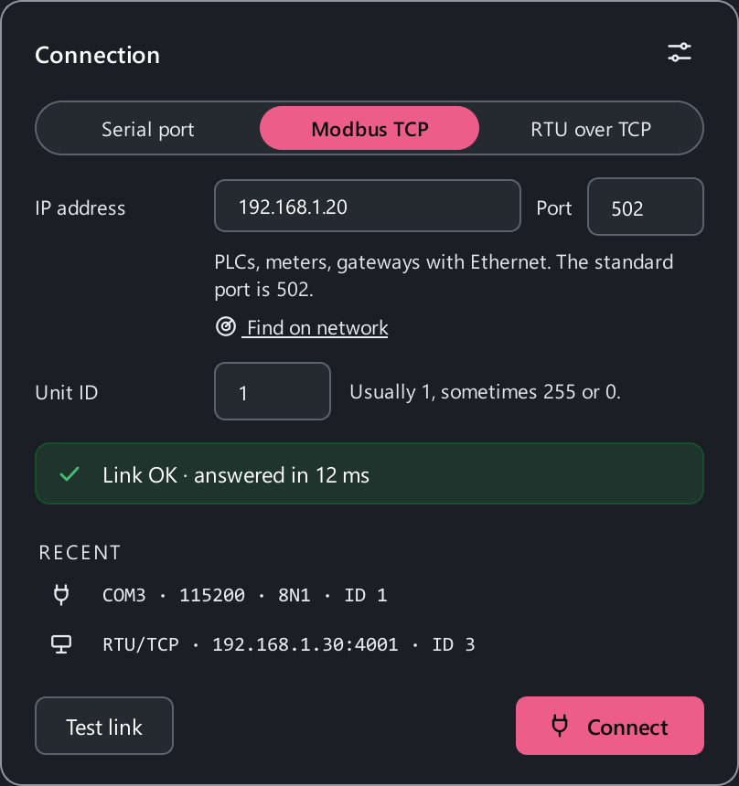

# Connect a device

ModbusReader talks to **Modbus RTU** devices through a serial port — RS-485
(most often) or RS-232, which needs an adapter — and to devices on a network:
over **Modbus TCP** and through RS-485 ↔ Ethernet converters in **RTU over
TCP** mode (see [Connecting over the network](#tcp)).

## The connection card { #card }

Click the link settings in the window header (`COM3 · 9600 · 8E1 · ID 10`) —
the connection card opens. It holds everything needed to reach a device:

{ width="404" }

- the **interface** — Serial port, Modbus TCP or RTU over TCP;
- the fields for it: port and framing for a COM port, IP address and port
  for the network, the device address;
- **Test link** — one request to the device and an answer in words: "Link OK ·
  answered in 12 ms" or what exactly is wrong;
- **Recent** — connections that worked before, one click away;
- **Connect** — apply and start polling.

The rest — timeouts, byte order, reconnecting — is behind **All connection
settings** (**Settings → Connection**). If a connection fails, the card opens
by itself and shows the reason.

## Adapter

Any USB-to-RS-485 adapter that the system sees as a COM port will do. The
most common ones use FTDI, CP210x (Silicon Labs) or CH340/CH341 chips. The
driver comes from the chip vendor; Windows 10/11 and Linux usually already
have it.

How to find the port:

=== "Windows"

    **Device Manager → Ports (COM & LPT)**: the adapter appears as
    `USB Serial Port (COM5)` or similar. The number changes if you plug the
    adapter into another USB socket. The port list is also in the
    connection card.

=== "Linux"

    ```bash
    ls /dev/ttyUSB* /dev/ttyACM*
    dmesg | tail      # right after plugging the adapter in
    ```

    Your user must be in the `dialout` group — see [Install](install.md#linux).

=== "macOS"

    ```bash
    ls /dev/cu.*
    ```

    Use the `cu.` devices, not `tty.`.

Adapters with automatic direction control (nearly all modern ones) need no
setup. One adapter — one port — one owner: while the port is being polled,
the sniffer and the emulator cannot open it.

## RS-485 wiring

RS-485 is a two-wire, half-duplex line on which the master polls up to 32
devices one after another (more with modern transceivers).

```text
  PC                        Device 1            Device 2 (last)
 +-------------+            +----------+        +----------+
 | USB-RS485 A |------------| A        |--------| A        |---+
 |             |            |          |        |          |   R  120 Ω
 |           B |------------| B        |--------| B        |---+  (terminator)
 |         GND |------------| GND      |--------| GND      |
 +-------------+            +----------+        +----------+
   A and B — twisted pair, GND — common ground
```

- **A to A, B to B.** Vendors name the lines differently: `A/B`, `D+/D−`,
  `485+/485−`, and sometimes A and B are swapped relative to the standard. If
  the device stays silent with correct settings — **swap A and B**, it is
  harmless.
- **A common ground (GND)** between the adapter and the devices. Without it
  the line may work on the desk and fail on site.
- **Twisted pair** for A/B, a daisy-chain bus from device to device, no long
  stubs and no star.
- **A 120 Ω terminator** between A and B at both ends of a long line (tens of
  metres and up, or high baud rates). A short cable on a desk usually does
  not need it. The symptom of trouble is CRC errors in the line statistics.

!!! warning "Power is separate"
    An RS-485 line carries no power. The device has its own supply; do not
    tie different power supplies together through the interface GND unless
    the device documentation says so.

## Link settings

In the connection card (or in **Settings → Connection**):

| Setting | Values | What matters |
|---|---|---|
| Port | `COM3`, `/dev/ttyUSB0`… | Pick from the list or type it in |
| Baud rate | 9600 · 19200 · 38400 · 57600 · 115200 · 230400 | As in the device. 9600 and 19200 are common |
| Parity | None (N) · Even (E) · Odd (O) | The Modbus standard is Even, but many devices default to N |
| Stop bits | 1 · 2 | Without parity the standard asks for 2; in practice 1 is common |

Data bits are always 8. The status bar shows the framing in short: `8N1` —
8 bits, no parity, 1 stop bit; `8E1` — even parity.

**The device address (Slave ID, 1–247)** is the **Address (ID)** field in the
card. You can also change it in the status bar at the bottom of the window:
click `ID: 1`, type a number and press ++enter++.

!!! note "Changes apply when you connect"
    Port settings apply to a new connection. If you change them while
    polling, reconnect (++f5++ twice). The device address applies at once.

## Connecting over the network { #tcp }

### Modbus TCP

PLCs, meters, drives with a network card, Modbus TCP ↔ RTU gateways. In the
connection card pick **Modbus TCP**:

| Field | What to enter |
|---|---|
| IP address | The device address, e.g. `192.168.1.20` |
| Port | `502` — the standard Modbus TCP port |
| Unit ID | Usually `1`; some devices want `255` or `0`. For a gateway — the address of the device on the RS-485 line behind it |

The computer and the device must be on the same network: a device at
`192.168.1.20` will not answer a computer at `192.168.0.5` until one of the
addresses is changed. Unit ID and the MBAP header are explained in
[Modbus TCP](modbus/tcp.md).

### RTU over TCP

RS-485 ↔ Ethernet converters in transparent mode (USR-TCP232, Moxa NPort and
the like) pass RTU frames over the network as they are. Pick **RTU over
TCP**: the converter's IP address and port (see its web interface) and the
device address on the line. Baud rate and parity of the line are set in the
converter itself. How transparent mode differs from a gateway:
[RTU over TCP and converters](modbus/rtu-over-tcp.md).

### If the device is silent

**Test link** tells at which step the link fails: the address is
unreachable, the port is closed, the connection is up but the device does not
answer. When the device is silent, the test tries what a newcomer cannot
know: unit IDs `1`, `255` and `0` and the other mode (Modbus TCP or RTU over
TCP). If an alternative works, the card offers it as one button: **Use 255**
or **Switch**.

### Find a device on the network

Don't know the IP address? Press **Find on network** in the card. The
[scanner](guide/scanner.md#network) opens in **Network (TCP)** mode: it walks
the addresses of your subnet and shows where Modbus answers. Double-click a
find to connect.

## Polling and timeouts

| Setting | Default | Meaning |
|---|---|---|
| Poll period | 500 ms | How often the whole map is read again |
| Response timeout | 1000 ms | How long to wait for an answer to one request |
| Failed polls before connection lost | 3 | After this many silent polls in a row the link counts as lost |
| Inter-frame delay | 50 ms | Pause between frames — for slow devices |

Every register of the map is read with its own request, the registers one
after another in a loop; the next round starts no sooner than one poll
period later. With a big map a round simply takes as long as it needs: the
app never sends a new request before the previous one is done. Writes,
macros and console frames jump the queue — between poll requests.

If a device answers slowly or "loses" every other request, raise the
**inter-frame delay** and the **response timeout**.

**Connection loss.** By default polling stops when the link is lost and you
press **Connect** again. Turn on **Keep polling on connection loss** to
have the app reconnect by itself at the set interval — handy for long
logging runs.

## Byte order

32- and 64-bit values span several registers, and vendors lay out the bytes
differently. The order is set in **Settings → Connection → Codecs — byte
order**, separately for SHORT, LONG and FLOAT. If a FLOAT reads `-775.2` or
`-107613728` instead of 24.6, it is the byte order. Details:
[Data types and byte order](modbus/data-types.md).

## Checking the link

1. In the connection card press **Test link** — the app asks the device one
   question and tells you in words what happened.
2. Press **Connect** (++f5++) and watch the **line statistics** in the
   bottom-right corner: a growing count of answers means the link works.
3. No answers at all — check the port, baud rate, parity, address and A/B
   polarity. Don't know the address or speed — run the
   [scanner](guide/scanner.md).
4. CRC errors — noise, no common ground or terminator, wrong parity.
5. Exceptions — the device answers but refuses the register address or the
   function: check the map and the [addressing](modbus/addressing.md).

More in [Troubleshooting](troubleshooting.md).
