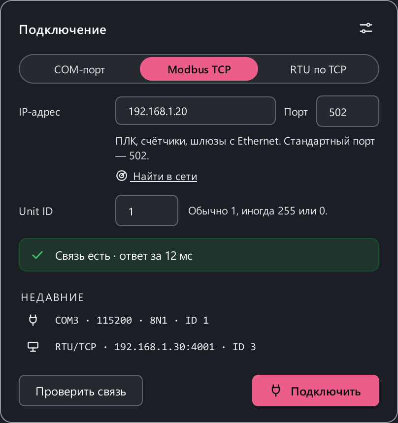

# Подключение к прибору

ModbusReader работает с приборами **Modbus RTU** через последовательный порт —
RS-485 (чаще всего) или RS-232, компьютеру для этого нужен адаптер, — и с
приборами в сети: по **Modbus TCP** и через преобразователи RS-485 ↔ Ethernet
в режиме **RTU по TCP** (см. [Подключение по сети](#tcp)).

## Карточка подключения { #card }

Щёлкните по параметрам связи в шапке окна (`COM3 · 9600 · 8E1 · ID 10`) —
откроется карточка подключения. В ней всё, что нужно, чтобы достучаться до
прибора:

{ width="404" }

- **интерфейс** — COM-порт, Modbus TCP или RTU по TCP;
- поля для него: порт и формат кадра для COM-порта, IP-адрес и порт для
  сети, адрес прибора;
- **«Проверить связь»** — один запрос прибору и ответ словами: «Связь есть ·
  ответ за 12 мс» или что именно не так;
- **«Недавние»** — подключения, которые уже работали, в один щелчок;
- **«Подключить»** — применить и начать опрос.

В демо-проекте есть ещё вариант **«Демо»** — его выдуманный прибор, без
кабеля и настроек ([что он умеет](quickstart.md#no-device)).

Остальное — таймауты, порядок байт, переподключение — по ссылке **«Все
настройки подключения»** (**Настройки → Подключение**). Если подключиться не
удалось, карточка откроется сама и покажет причину.

## Адаптер

Подойдёт любой USB-адаптер RS-485, который система видит как COM-порт.
Самые распространённые построены на микросхемах FTDI, CP210x (Silicon Labs) и
CH340/CH341. Драйвер ставится от производителя микросхемы; в Windows 10/11 и
Linux он обычно уже есть.

Как найти порт:

=== "Windows"

    **Диспетчер устройств → Порты (COM и LPT)**: адаптер появится как
    `USB Serial Port (COM5)` или похоже. Номер порта меняется, если
    вставить адаптер в другой USB-разъём. Список портов есть и в
    карточке подключения.

=== "Linux"

    ```bash
    ls /dev/ttyUSB* /dev/ttyACM*
    dmesg | tail      # сразу после подключения адаптера
    ```

    Пользователь должен состоять в группе `dialout` — см. [Установка](install.md#linux).

=== "macOS"

    ```bash
    ls /dev/cu.*
    ```

    Используйте устройства `cu.`, а не `tty.`.

Адаптеры с автоматическим переключением направления (почти все современные)
не требуют настройки. Один адаптер — один порт — один владелец: если порт
открыт опросом, сниффер и эмулятор на нём не запустятся.

## Проводка RS-485

RS-485 — двухпроводная линия (полудуплекс), на которой мастер по очереди
опрашивает до 32 приборов (с современными приёмопередатчиками — больше).

```text
  Компьютер                 Прибор 1            Прибор 2 (последний)
 +-------------+            +----------+        +----------+
 | USB-RS485 A |------------| A        |--------| A        |---+
 |             |            |          |        |          |   R  120 Ом
 |           B |------------| B        |--------| B        |---+  (терминатор)
 |         GND |------------| GND      |--------| GND      |
 +-------------+            +----------+        +----------+
   A и B — витая пара, GND — общий провод
```

- **A к A, B к B.** Производители по-разному называют линии: `A/B`, `D+/D−`,
  `485+/485−`, иногда A и B перепутаны относительно стандарта. Если прибор
  молчит при верных параметрах — **поменяйте A и B местами**, это безопасно.
- **Общий провод (GND)** между адаптером и приборами. Без него линия может
  работать на столе и сбоить на объекте.
- **Витая пара** для A/B, топология «шина» — от прибора к прибору, без
  длинных отводов и «звезды».
- **Терминатор 120 Ом** между A и B на двух концах длинной линии (от
  десятков метров и на высоких скоростях). На коротком проводе на столе он
  обычно не нужен. Признак проблемы — ошибки CRC в статистике линии.

!!! warning "Питание отдельно"
    Линия RS-485 не передаёт питание. Прибор питается от своего источника;
    не соединяйте разные источники питания через провод GND интерфейса,
    если в документации прибора не сказано обратное.

## Параметры связи

В карточке подключения (или в **Настройки → Подключение**):

| Параметр | Значения | Что важно |
|---|---|---|
| Порт | `COM3`, `/dev/ttyUSB0`… | Можно выбрать из списка или ввести вручную |
| Скорость | 9600 · 19200 · 38400 · 57600 · 115200 · 230400 | Как в приборе. Частые значения — 9600 и 19200 |
| Чётность | None (N) · Even (E) · Odd (O) | Стандарт Modbus — Even, но многие приборы по умолчанию N |
| Стоп-биты | 1 · 2 | Без чётности стандарт требует 2, на практике часто 1 |

Биты данных всегда 8. В строке состояния формат показан сокращённо:
`8N1` — 8 бит, без чётности, 1 стоп-бит; `8E1` — с чётностью Even.

**Адрес прибора (Slave ID, 1–247)** — поле **«Адрес (ID)»** в карточке. Его
же можно поменять в строке состояния внизу окна: щёлкните по `ID: 1`, введите
число и нажмите ++enter++.

!!! note "Изменения применяются при подключении"
    Параметры порта действуют для нового подключения. Если поменяли их во
    время опроса — переподключитесь (++f5++ дважды). Адрес прибора меняется
    сразу.

## Подключение по сети { #tcp }

### Modbus TCP

ПЛК, счётчики, частотники с сетевой картой, шлюзы Modbus TCP ↔ RTU. В
карточке подключения выберите **Modbus TCP**:

| Поле | Что вводить |
|---|---|
| IP-адрес | Адрес прибора, например `192.168.1.20` |
| Порт | `502` — стандартный порт Modbus TCP |
| Unit ID | Обычно `1`, у некоторых приборов `255` или `0`. У шлюза — адрес прибора на линии RS-485 за ним |

Компьютер и прибор должны быть в одной сети: прибор `192.168.1.20` с
компьютера `192.168.0.5` не ответит, пока не поправить адрес одного из них.
Что такое Unit ID и заголовок MBAP — в разделе [Modbus TCP](modbus/tcp.md).

### RTU по TCP

Преобразователи RS-485 ↔ Ethernet в прозрачном режиме (USR-TCP232, Moxa
NPort и подобные) пересылают кадры RTU по сети как есть. Выберите **RTU по
TCP**: IP-адрес и порт преобразователя (их видно в его веб-интерфейсе) и
адрес прибора на линии. Скорость и чётность линии задаются в самом
преобразователе. Чем прозрачный режим отличается от шлюза —
[RTU по TCP и преобразователи](modbus/rtu-over-tcp.md).

### Если прибор молчит

**«Проверить связь»** объясняет, на каком шаге связь не складывается:
адрес недоступен, порт закрыт, соединение есть, но прибор не отвечает.
Если прибор молчит, проверка сама пробует то, чего новичок знать не может:
Unit ID `1`, `255` и `0` и второй режим (Modbus TCP или RTU по TCP). Нашёлся
рабочий вариант — карточка предложит его одной кнопкой: **«Взять 255»** или
**«Переключить»**.

### Найти прибор в сети

Не знаете IP-адрес — нажмите **«Найти в сети»** в карточке. Откроется
[сканер](guide/scanner.md#network) в режиме **«Сеть (TCP)»**: он перебирает
адреса вашей подсети и показывает, где отвечает Modbus. Двойной щелчок по
найденному — подключиться.

## Опрос и таймауты

| Параметр | По умолчанию | Смысл |
|---|---|---|
| Период опроса | 500 мс | Как часто перечитывается вся карта |
| Таймаут ответа | 1000 мс | Сколько ждать ответа на один запрос |
| Неудачных опросов до потери связи | 3 | После стольких подряд без ответа связь считается потерянной |
| Пауза между запросами | 50 мс | Пауза между кадрами — для медленных приборов |

Каждый регистр карты читается своим запросом, регистры — подряд по
кругу; следующий круг начинается не раньше, чем через период опроса. Если
карта большая, круг просто займёт столько, сколько нужно: программа не шлёт
новый запрос, пока не закончился предыдущий. Запись, макросы и кадры из
консоли идут вне очереди — между запросами опроса.

Если прибор отвечает медленно или «теряет» каждый второй запрос — увеличьте
**паузу между запросами** и **таймаут**.

**Потеря связи.** По умолчанию при потере связи опрос останавливается, и
нужно снова нажать **«Подключить»**. Включите **«Молча опрашивать при потере
связи»**, чтобы программа переподключалась сама с заданным интервалом —
удобно для долгой записи логгером.

## Порядок байт

32- и 64-битные значения занимают несколько регистров, и производители
раскладывают байты по-разному. Порядок задаётся в **Настройки → Подключение
→ Кодеки** отдельно для SHORT, LONG и FLOAT. Если FLOAT читается как
`-775.2` или `-107613728` вместо 24.6 — дело в порядке байт. Подробно — в
разделе [Типы данных и порядок байт](modbus/data-types.md).

## Проверка связи

1. В карточке подключения нажмите **«Проверить связь»** — программа задаст
   прибору один вопрос и скажет словами, что получилось.
2. Нажмите **«Подключить»** (++f5++) и смотрите на **статистику линии** в
   правом нижнем углу: растёт счётчик ответов — связь есть.
3. Нет ответов вообще — проверьте порт, скорость, чётность, адрес и
   полярность A/B. Не знаете адрес или скорость — запустите
   [сканер](guide/scanner.md).
4. Есть ошибки CRC — помехи, нет общего провода или терминатора,
   неверная чётность.
5. Есть исключения — прибор отвечает, но не принимает адрес регистра или
   функцию: проверьте карту и [адресацию](modbus/addressing.md).

Подробнее — в разделе [Решение проблем](troubleshooting.md).
