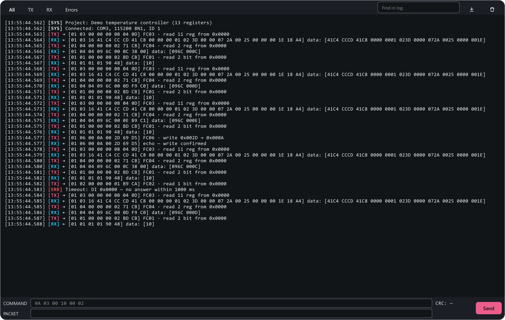

# Console

The **Console** (++ctrl+3++) is the transaction log full screen plus a line
for sending any frame you like. The same line also sits under the log on the
register map page (the button to the right of the log shows and hides it).

## Sending a frame

Two rows:

- **Command** — the frame without CRC, in hex: device address, function,
  data. Spaces, commas and `0x` are all fine: `01 03 00 00 00 02`,
  `0x01, 0x03, 0x00, 0x00, 0x00, 0x02` and `010300000002` are the same thing.
  Every byte is two digits: `00`, not `0`. On the right the app shows the
  computed **CRC** at once.
- **Packet** — what actually goes to the port: the command + CRC. You can
  edit it by hand — break the CRC to see how the device reacts, or send a
  frame of another protocol. A manual edit is marked with an **edited**
  badge until you change the command again.

++enter++ or **Send** — send. ++arrow-up++ / ++arrow-down++ — the history of
the last 20 commands (kept between runs).

The device's answer appears in the log as an `[RX]` line. The console works
through the open connection: press **Connect** (++f5++) first. A console
frame jumps the queue, between poll requests.

## Handy frames

Device 1; the console adds the CRC:

| Task | Command |
|---|---|
| Read 2 holding registers from address 0 | `01 03 00 00 00 02` |
| Read 1 input register from address 0 | `01 04 00 00 00 01` |
| Read 8 coils from address 0 | `01 01 00 00 00 08` |
| Write 25 to holding register 2 | `01 06 00 02 00 19` |
| Turn coil 0 on | `01 05 00 00 FF 00` |
| Turn coil 0 off | `01 05 00 00 00 00` |
| Write FLOAT 25.0 (ABCD) to registers 2–3 in one request | `01 10 00 02 00 02 04 41 C8 00 00` |
| The same for device 10 | `0A 10 00 02 00 02 04 41 C8 00 00` |

The frame structure is in [What is Modbus RTU](../modbus/index.md), the
function codes in [Functions and errors](../modbus/functions.md).

## Transaction log

The log shows every frame with a timestamp, its direction (`TX` — sent, `RX` —
received), the bytes and a decoding: function, address, count, data, write
echo. The **All / TX / RX / Errors** filters, search, saving to `.txt` and
clearing are above the log. How much is decoded — **Settings → Log →
Verbosity**.
