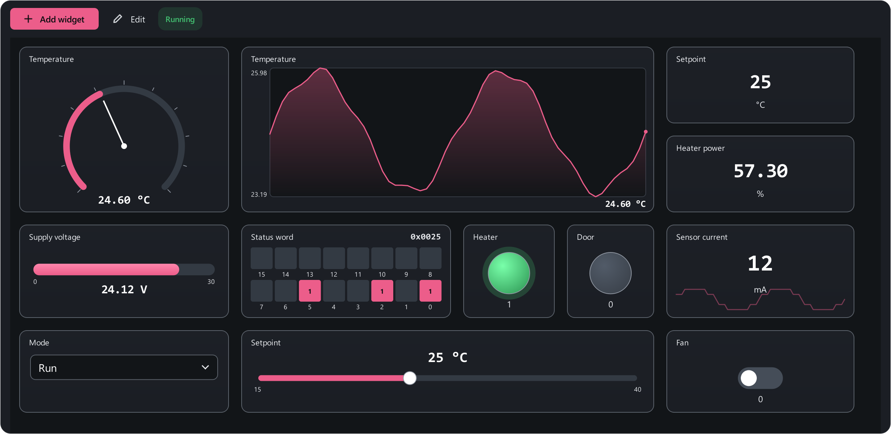

# Dashboard

The dashboard (++ctrl+6++) is your own operator panel: widgets are placed
freely and bound to registers of the map. Values update while polling runs.
And **wires** between widgets give simple automation: "timer → button →
write to the device".

## Two modes

- **Running** — widgets are live: buttons write, timers tick, sliders move.
  Nothing can be moved by accident.
- **Editing** (the **Edit** button, ++ctrl+e++) — widgets are dragged and
  resized, and ports for wires appear. **Nothing is written to the device in
  this mode**: timers are stopped, buttons are inert. **Done** returns to
  running.

## Widgets

**Add widget** → pick a kind and a register from the map.

### Readouts

| Widget | For |
|---|---|
| **Value** | A big number with its unit and a sparkline of recent samples |
| **Lamp** | Lights up when the value passes a threshold: on, alarm flags. Can be inverted |
| **Bar** | A min…max scale — shows at a glance where the value sits |
| **Gauge** | A dial with a needle and an alarm zone |
| **Bits** | The register split into its 16 bits — for status words; read-only |
| **Chart** | A trend of recent samples right on the dashboard |

### Controls

| Widget | Writes |
|---|---|
| **Button** | A set value to the register when pressed |
| **Input** | Type a value, ++enter++ — it goes to the register |
| **Toggle** | Switches the register between two values |
| **Slider** | Drag to choose, release to write. For setpoints; has a step and a **Write while dragging** mode |
| **Select** | The labels of the register's enum; picking one writes it at once |

### Logic

| Widget | Does |
|---|---|
| **Timer** | Periodically "presses" whatever it is wired to. Interval in ms, autostart. Click it while running to start/stop |
| **Gate** | Passes the pulse on only while its own register satisfies the condition: `>`, `≥`, `<`, `≤`, `=`, `≠` |
| **Label** | Just text — to label areas of the panel |

Double-click a widget in edit mode for **Widget settings**: title, unit,
min/max, **Alarm: below** and **Alarm: above**, button and toggle values,
slider step, the gate condition and so on.

## Wires and automation

In edit mode the widgets that can take part in a chain show port dots:
**output on the right, input on the left**. Drag from the right dot of one
widget to the left dot of another — that is a wire.

How a chain works:

- When a widget fires — a button is pressed, a timer ticks, a value is
  entered — it performs its own action, and **the pulse travels on along its
  wires**, and every connected widget performs its action.
- **Button, toggle, input, slider, select** write their value to the
  register on an incoming pulse. If the source is an input, slider or select,
  **its value** travels down the wire, and the next widget writes exactly
  that.
- A **timer** starts or stops on an incoming pulse.
- A **gate** passes the pulse only if the condition holds. If the register
  value is unknown (no link), it **does not pass**: the chain will not write
  to the device blindly.

Pulses are visible: the wire lights up and widgets flash — you can see how
far the chain got and where it stopped.

Example: **Timer (1000 ms) → Gate (Temperature > 30) → Button "Fan: 1"** —
check the temperature once a second and turn the fan on when it is hot. Step
by step: [Dashboard automation](../examples/dashboard-automation.md).

To delete a wire, select it and press ++del++, or right-click → **Delete
wire**.

## Editing

| Action | How |
|---|---|
| Select several | Drag a box on empty canvas, ++ctrl++ + click adds |
| Copy / cut / paste | ++ctrl+c++ / ++ctrl+x++ / ++ctrl+v++ |
| Duplicate | ++ctrl+d++ |
| Select all | ++ctrl+a++ |
| Nudge | Arrows, with ++shift++ by 10 |
| Delete a widget or wire | ++del++ |
| Zoom | Mouse wheel, ++ctrl+0++ resets |
| Pan | Drag with the right mouse button |

While dragging, widgets snap to their neighbours' edges and centres; hold
++alt++ for exact pixel placement.

## Several dashboards

A project can hold any number of dashboards — "Panel" and "Commissioning",
say. The **Manage dashboards** menu: new, rename, duplicate, delete, **save
dashboard to file** `.mbdash` and **load dashboard from file** — to move a
panel to another project. Every dashboard is saved in the `.mbproj` project.

Right-click a widget → **Add to watch** puts its register into the
[watch window](trends.md#watch).
