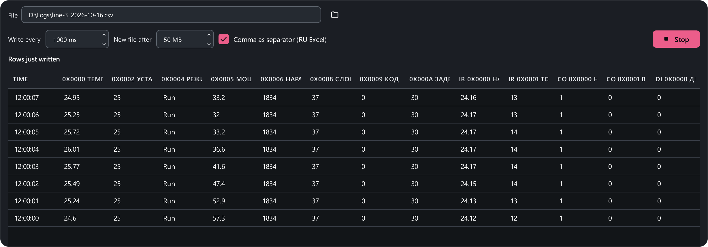

# Logger

The **Logger** (++ctrl+8++) writes the values of every map register to CSV —
for hours and days. The file opens in Excel with a double-click.



1. **File** — where to write (the **Choose a file…** button). If the file
   exists, the app asks whether to overwrite it or take a new name.
2. **Write every** — the period, from 100 ms (1000 ms by default).
3. **New file after** — the size of a part, 1 to 2000 MB (50 by default).
   Later parts are named `name_002.csv`, `name_003.csv`…
4. **Comma as separator (RU Excel)** — for Excel set to a locale with
   decimal commas: columns separated by `;`, decimals with a comma. Untick it
   for `,` and a decimal point.
5. **Start logging**.

Under the settings are the columns of the future file, a forecast
("13 columns · roughly 3600 rows and 0.4 MB per hour") and the rows just
written.

## File format

One row is one instant, one column is one register:

```text
timestamp,"0x0000 Temperature, °C","0x0005 Heater power, %","IR 0x0000 Supply voltage, V"
2026-10-16 12:00:00.000,24.6,57.3,24.12
2026-10-16 12:00:01.000,24.7,57.1,24.13
```

- Values are in engineering units, as in the table; enums are written as
  their labels.
- If a register was not read this cycle, its cell is empty — columns never
  shift.
- UTF-8 with a BOM — Excel reads non-Latin names correctly.
- The column set is fixed at start: to add a register, stop and start again.

The logger writes what polling brings in — polling must be running. For long
runs turn on **Settings → Connection → Keep polling on connection loss**, so
a short line drop does not stop everything until morning. If the disk fills
up or the file is locked, logging stops with a message and the app keeps
working.
