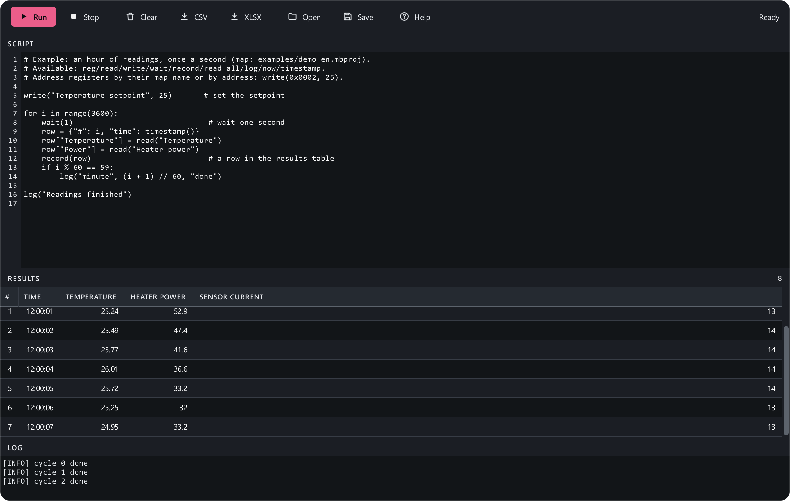

# Macros

**Macros** (++ctrl+m++) are plain Python scripts that read and write device
registers, wait, check conditions and build a **results table**. They
automate acceptance tests, calibration, setpoint sweeps and long
measurements.



## How it works

1. Connect to the device (++f5++) — a macro will not start without a link.
2. Write a script in the editor and press **Run**.
3. Every `record(...)` call adds a row to **Results**; `log(...)` writes to
   the **Log** at the bottom.
4. **Stop** interrupts the macro at any moment — even an endless loop.
5. Save the finished table as **CSV** or **XLSX** (Excel).

A macro runs in the background: you can switch to other pages, and its
requests interleave with map polling. The last script is kept between runs;
**Save** / **Open** work with `.py` files. **Help** opens the command list
right in the app.

## A first macro

```python
# Read the temperature 10 times, once a second
for i in range(10):
    t = read("Temperature")
    record({"#": i, "time": timestamp(), "temperature": t})
    wait(1)
log("done")
```

## Commands

### Registers

`read(register)`
:   Read a register and return its value: a number, 0/1 for bits, text for
    `STRING`.

`write(register, value)`
:   Write a value. Returns the written value. If the device does not
    acknowledge the write — an error.

`reg(register)`
:   A register object with `.read()`, `.write(v)` and a `.value` property
    (reads on every access) — handy when you need a register many times:
    `t = reg("Temperature")`, then `t.value`.

`read_all()`
:   Read every numeric register of the map and return a
    `{name: value}` dict. Handy for a report row: `record(read_all())`.

**Naming a register:**

| How | Example |
|---|---|
| By its map name (English or Russian, case does not matter) | `read("Temperature")`, `read("temperature")` |
| By holding register address | `read(0x0A)`, `read(10)`, `read("0x0A")` |
| By address in another table | `read("IR 0x01")`, `read("CO 5")`, `read("DI 3")` |
| An address that is not in the map — with a type | `read(0x0100, "FLOAT")`, `write(0x0200, 5, "UINT16")` |

If a register is not in the map and no type is given, the macro stops with
a clear error.

!!! warning "Raw values"
    Macros work with **raw** values — without the map's scaling and enums.
    For "Heater power" with scale 0.1, `read()` returns 573, not 57.3; the
    mode "Run" comes back as 1. Apply the scale yourself:
    `read("Heater power") * 0.1`.

### Time and waiting

`wait(seconds)` · `sleep(seconds)`
:   Pause; fractions are fine: `wait(0.5)`. **Stop** cuts it short at once.

`now()`
:   The current time in seconds (a float) — for measuring durations:
    `t0 = now()` … `log(now() - t0)`.

`timestamp()`
:   Date and time as a `YYYY-MM-DD HH:MM:SS` string — a handy table column.

### Results and log

`record(dict)` · `record(column=value, …)`
:   Add a row to the results table. Columns are created from the keys
    automatically, in order of first appearance:
    `record({"step": 1, "t": 24.6})` or `record(step=1, t=24.6)`.

`log(...)` · `print(...)`
:   Print a message to the log: `log("setpoint", sp, "reached")`.

## What Python offers

Plain Python: variables, `for` and `while` loops, conditions, functions,
lists and dicts, `try` / `except`. Of the built-ins: `abs`, `min`, `max`,
`round`, `sum`, `len`, `range`, `enumerate`, `zip`, `map`, `filter`,
`sorted`, `reversed`, `int`, `float`, `str`, `bool`, `list`, `dict`, `tuple`,
`set`, `divmod`, `pow`, `bin`, `hex`, `oct`, `ord`, `chr`, `format`, `repr`,
`any`, `all`, `isinstance`.

**Not allowed:** `import` (no `math`, `time` or other modules), `open`,
`eval`, `exec` and double-underscore names (`__class__` and the like). These
are guard-rails against accidents, not a sandbox: a macro is code that runs
with the app's rights. So a script **opened from a file** asks for
confirmation before its first run. Only run what you trust.

## Errors

- **Syntax error** — the macro does not start; the log shows the line number.
- **No answer from the device** — `read()` and `write()` raise an error
  (`RuntimeError`); one operation gets up to 5 seconds. Catch it to ride out
  an occasional timeout:

    ```python
    try:
        v = read("Temperature")
    except RuntimeError:
        v = None
        log("no answer, skipping")
    ```

- Any unhandled error stops the macro; the log shows the error type and the
  line number. Rows already in the table stay.

Closing the app with a running macro or with unexported results asks first.

## Ready-made examples

A setpoint sweep that waits for stabilisation, checking every register
against a reference, step calibration, waiting for an event with a timeout,
an acceptance report — in [Macro examples](../examples/macros.md).
