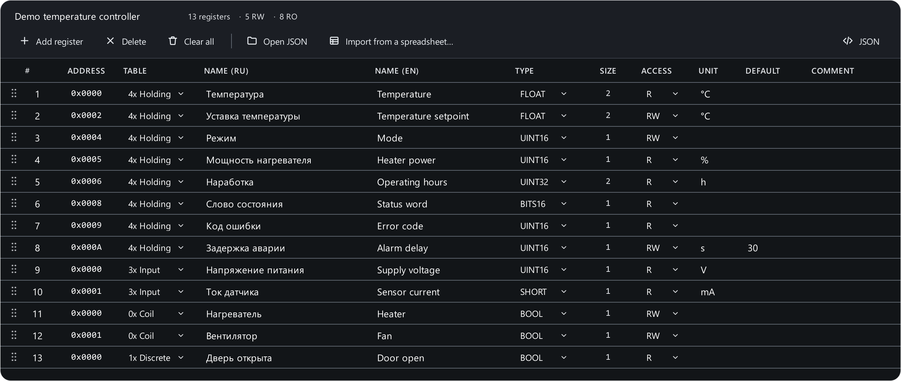

# Map editor and import

The register map describes a device: which registers it has, where they
sit, what type they are and how to show them. The editor opens with **Edit
map** above the table, ++ctrl+2++ or from the project menu (**Create register
map…**).



## Columns

| Column | Meaning |
|---|---|
| ADDRESS | Zero-based. It follows the previous register, taking its size into account; double-click to type one (`0x10`, `10h` or `16`). Registers packed right after it move along |
| TABLE | 4x Holding, 3x Input, 0x Coil, 1x Discrete — see [Tables and addresses](../modbus/addressing.md) |
| NAME (RU) / NAME (EN) | Russian and English names; the table shows the one of the UI language |
| TYPE | Data type — every type has a hint in the list; see [Data types](../modbus/data-types.md) |
| SIZE | How many addresses the register takes. Fixed for fixed types; set it for `STRING`: 10 = 20 characters |
| ACCESS | R, RW or W. Input and discrete are always R |
| UNIT | Unit of measure: `°C`, `V`, `%` |
| DEFAULT | The value the [emulator](slave.md) starts with |
| COMMENT | Any note for yourself |

Coils and discrete inputs are always `BOOL`, size 1 — the app sets that
itself when you pick the table.

## Actions

- **Add register** — a new row after the last one.
- **Drag** a row with the mouse to reorder (++esc++ while dragging cancels).
- Right-click a row: **Engineering units…**, **Duplicate**, **Delete**
  (++del++).
- ++ctrl+z++ / ++ctrl+shift+z++ — undo and redo.
- **Clear all** — remove every register.
- **JSON** — show the map as file text.

At the bottom of the editor are counters: how many registers, whether there
are **address overlaps** (a FLOAT at 0x0002 and a register at 0x0003 take
the same place) and **duplicate names**. An overlap almost always means a
mistake in the map.

### Scaling and enumeration

**Engineering units…** in the row menu:

- **Scale** and **Offset**: `displayed = raw × scale + offset`. The device
  sends 573, scale 0.1 — the table shows 57.3.
- **Enum** — one value per line:

    ```text
    0 = Stop
    1 = Run
    2 = Fault
    ```

More in [Data types](../modbus/data-types.md#scaling).

## Apply and save

- **Apply** — show the map in the main window **without** saving a file.
  Handy for checking and fixing on the go.
- **Save** (++ctrl+s++) / **Save as…** (++ctrl+shift+s++) — to a standalone
  `.json` map file. The file name is suggested from the map name field.
- If the map is part of a [project](projects.md), saving the project is
  enough: the map is stored inside it.

Close the editor with ++esc++; with unsaved edits the app asks what to do
with them.

## Import from CSV and Excel { #import }

Most devices have their register map in the datasheet — as a table. No need
to retype it: in the editor press **Import from a spreadsheet…** and pick a
`.csv`, `.txt`, `.xlsx` or `.xlsm` file.

The app detects the encoding (UTF-8, Windows-1251) and the delimiter
(`;`, `,`, tab) by itself and tries to guess the columns from their headers —
"Address", "Name", "Data type", "Unit", "Адрес", "Наименование"… The guess
can always be corrected.

In the import dialog:

1. **Sheet** — for an Excel workbook with several sheets.
2. **First row is a header** — untick if there is no header.
3. **Address format** — the key choice:
    - **As written (zero-based)** — `0`, `0x0010`, `10h` — the protocol
      address;
    - **One-based (1 = register 0)** — "register 1" in the datasheet is
      address 0;
    - **4x / 3x (40001 = register 0)** — Modicon notation; the table comes
      from the first digit: 4xxxx — holding, 3xxxx — input, 1xxxx — discrete.

    If many addresses in the file are above 30000, the app warns that it
    looks like the 4x convention — otherwise the whole map shifts.
4. **Columns** — for every column of the file choose what it holds: Address,
   Name, Type, Access, Length, Unit, Scale, Offset, Comment, Name (EN),
   Table — or "ignore". Only the address is required.
5. At the bottom — how many registers will be imported and a list of issues:
   unparsable addresses, addresses outside 0…0xFFFF, duplicates.
6. **Replace the current map** or **Append to the current map** → **Import**.

The app understands types the way vendors write them: `int16`, `uint16`,
`word`, `int32`, `dword`, `real`, `float32`, `lreal`, `bcd`, `string`,
`ascii`… Access: `R`, `RO`, `R/W`, `read`, `write`… Table: `holding`, `HR`,
`4x`, `FC03`, `input`, `coil`, `discrete input`…

A step-by-step example: [Map from a datasheet](../examples/datasheet-import.md).

## The map file format { #file-format }

A map is plain JSON, easy to keep in git and edit by hand:

```json
{
  "format": "modbusreader.profile",
  "version": 2,
  "name": "Temperature controller",
  "registers": [
    {"addr": 0, "name": "Температура", "name_en": "Temperature",
     "type": "FLOAT", "length": 2, "rw": "R", "unit": "°C"},
    {"addr": 4, "name": "Mode", "type": "UINT16", "length": 1, "rw": "RW",
     "enum": {"0": "Stop", "1": "Run", "2": "Fault"}},
    {"addr": 5, "name": "Power", "type": "UINT16", "length": 1, "rw": "R",
     "unit": "%", "scale": 0.1},
    {"addr": 0, "area": "coil", "name": "Heater", "type": "BOOL",
     "length": 1, "rw": "RW"}
  ]
}
```

- `addr` — zero-based address (a string `"0x10"` works too);
- `area` — `input`, `coil` or `discrete`; absent means holding;
- `rw` — `R`, `RW` or `W`;
- `scale`, `offset`, `enum`, `unit`, `default`, `comment`, `name_en` —
  optional.

Files saved by older versions always open: the format is versioned and
upgraded on load.
