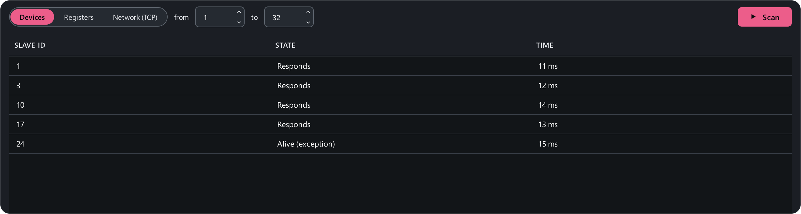

# Scanner

The **Scanner** (++ctrl+4++) answers three questions: *who is on the line*,
*which addresses a device answers* and *where the Modbus TCP devices are on
the network*. The Devices and Registers modes work through the open
connection — press **Connect** (++f5++) first; map polling carries on during
the scan. The Network (TCP) mode needs no connection.

## Modes

**Devices** — sweeps the device addresses (Slave ID) in the range 1…247.
Each one is sent a read of one holding register at address 0. A device counts
as found if it answered:

- **Responds** — returned data;
- **Alive (exception)** — answered with a Modbus error. That is a **hit**
  too: the device is on the line and decoded the request, it just has no
  register 0. Read it at the addresses from its documentation.

**Registers** — sweeps holding register addresses on **one** device (its
address is set alongside). Every address that answered is listed with its
raw value — a way to find a device's live registers with no documentation.

Over a Modbus TCP connection the Devices mode sweeps the **unit ID** — the way
to find the devices behind a Modbus TCP ↔ RTU gateway.

### Network (TCP) { #network }

Finds Modbus TCP devices on the local network when the IP address is unknown.
Pick a subnet (the app offers this computer's subnets, or **Custom range…** —
up to 1024 addresses) and a port (usually 502), then press **Scan**. The
scanner knocks on the port at every address at once and asks everyone who
opened a connection. In the table:

- **Modbus · unit ID 1** — the device answers over Modbus TCP;
- **Modbus · unit ID 1 · exception 02** — a hit too: the device is there, it
  just has no register 0;
- **port open, Modbus silent** — something listens on the port, but not
  Modbus TCP: for example a converter in [RTU over TCP](../modbus/rtu-over-tcp.md)
  mode.

**Double-click** a row to connect to that device. The **Find on network**
button in the [connection card](../connect.md#card) leads here too.

Every hit shows its response time in milliseconds. At the end — a summary:
"Found 5 of 32 · 6.4 s". The scan runs in the background; press the button
again to stop it.

## Scan speed

A silent address costs a full **response timeout** (**Settings → Connection
→ Response timeout**, 1000 ms by default). Sweeping all 247 addresses with a
1 s timeout takes about four minutes. To speed it up:

- narrow the range if you roughly know the address;
- lower the timeout to 200–300 ms — most devices answer within 10–50 ms.
  Remember to set it back for normal work.

## If the baud rate is unknown { #unknown-baud }

The scanner searches at one baud rate and parity — the ones in the settings.
If the device parameters are unknown, go through them in turn: start with
**9600 8N1**, **19200 8N1**, **9600 8E1**, **19200 8E1**, then 38400 and
115200 — reconnect for each (++f5++ twice) and run a device scan over a
narrow range (say 1…10). Most devices ship with address 1.

CRC errors in the line statistics while you search mean the baud rate is
close but wrong, or the parity is wrong.
