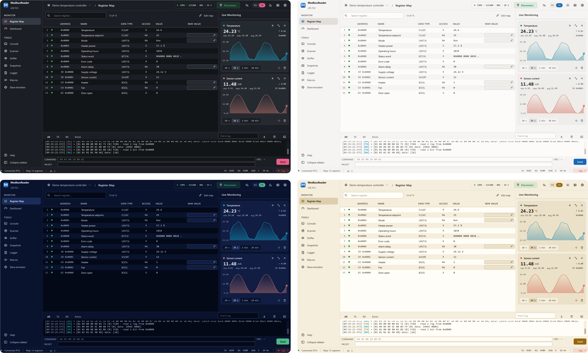

# Settings and shortcuts

**Settings** — ++ctrl+comma++ or the gear in the top-right corner of the
window. Changes apply with **Save**; if you leave without saving, the app
warns you.

## Connection

The interface — serial port, Modbus TCP or RTU over TCP; port, baud rate,
parity, stop bits or IP address and TCP port; poll period, response timeout, failed
polls before the connection counts as lost, inter-frame delay; byte order for
SHORT, LONG and FLOAT; what to do on connection loss. All of it in detail in
[Connect a device](../connect.md) and
[Data types and byte order](../modbus/data-types.md).

## General

- **Interface language** — English or Russian, switches without a restart.
  The RU/EN switch is also in the window header.
- **Startup** — reopen the map or project you worked with last time.
- **Updates** — check automatically (at start-up and every few hours) and a
  **Check now** button. The installed app installs an update in the
  background and offers a restart — see [Install](../install.md#updates).

## Appearance

- **Theme** — dark or light (quick switch: ++ctrl+t++).
- **Colour scheme** — dark: Graphite, Carbon, Midnight, Slate; light: Paper,
  Snow, Sand.
- **Contrast** — Soft, Normal, High. High is for a bright shop floor or a
  projector.
- **Accent color** — 12 options for selection and indicators.
- **Menu** — where the page menu sits: **left**, **top** or **right**, and
  **Icons only** (the names move into the tooltips). Which pages the menu
  lists — right-click the menu itself; the register map cannot be removed,
  and hidden pages still open with their shortcuts. When the window is too
  narrow for a menu on top, it keeps the icons and the name of the open page.
- **Interface font** — any font installed on the system, plus **font size**
  and table **row height**; the sample updates live.

At the first start a "Welcome" card offers the theme, accent colour, menu and
font — every pick shows on the whole window at once.

## Table

Column visibility (address, name, type, access, value, new value), **zebra
striping**, **monospace values** and **highlight changes** — a row flashes
when its value changes.

## Graphs

Default time window (10 s … 10 min), auto-fit Y for new charts, line
smoothing, history buffer per register, trend panel width. See
[Trends](trends.md).

## Log

Whether the transaction log is visible, its height, auto-scroll to new
entries, **verbosity** (Min, Normal, Debug) and **max entries** (50…2000,
older ones roll out).

## Keyboard shortcuts

The full list is in **Settings → Hotkeys**.

### Global

| Action | Keys |
|---|---|
| Connect / disconnect | ++f5++ |
| Watch window | ++f6++ |
| Help — a tour of the current page | ++f1++ |
| Settings | ++ctrl+comma++ |
| Dark / light theme | ++ctrl+t++ |
| Search register | ++ctrl+f++ |
| Close settings or the editor | ++esc++ |

### Pages

| Page | Keys |
|---|---|
| Register map | ++ctrl+1++ |
| Map editor | ++ctrl+2++ |
| Console | ++ctrl+3++ |
| Scanner | ++ctrl+4++ |
| Sniffer | ++ctrl+5++ |
| Dashboard | ++ctrl+6++ |
| Snapshots | ++ctrl+7++ |
| Logger | ++ctrl+8++ |
| Slave emulator | ++ctrl+9++ |
| Macros | ++ctrl+m++ |

### Project and map

| Action | Keys |
|---|---|
| New project | ++ctrl+n++ |
| Open project | ++ctrl+o++ |
| Save project | ++ctrl+s++ |
| New map | ++ctrl+shift+n++ |
| Open map | ++ctrl+shift+o++ |

### Register table

| Action | Keys |
|---|---|
| Type a new value | ++f2++ |
| Next / previous row in the column | ++tab++ / ++shift+tab++ |
| Register menu | right mouse button |
| Inspect a memory area | double-click |
| Log this register's frames | the button next to the state dot (shows when you hover the row) |

### Map editor

| Action | Keys |
|---|---|
| Undo / redo | ++ctrl+z++ / ++ctrl+shift+z++ |
| Save the map / as… | ++ctrl+s++ / ++ctrl+shift+s++ |
| Delete the row | ++del++ |

### Dashboard

| Action | Keys |
|---|---|
| Edit mode | ++ctrl+e++ |
| Zoom / reset | wheel, ++ctrl+plus++ / ++ctrl+minus++ / ++ctrl+0++ |
| Copy / cut / paste | ++ctrl+c++ / ++ctrl+x++ / ++ctrl+v++ |
| Duplicate the widget | ++ctrl+d++ |
| Select all | ++ctrl+a++ |
| Delete the widget or wire | ++del++ |
| Nudge the selection | arrows, with ++shift++ by 10 |

## About

Version, the GPL-3.0 licence, links to the source code and to the project
support page.
