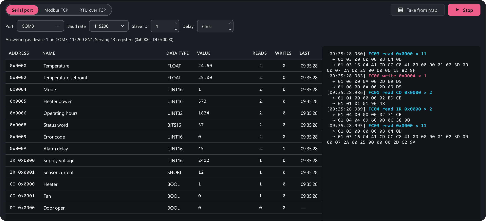

# Slave emulator

The **Slave emulator** (++ctrl+9++) turns ModbusReader into a device: the app
answers someone else's master — a SCADA, an operator panel, a controller —
from the open register map. That way you can debug the upper level when the
device does not exist yet, is far away, or is too precious to risk.

## Starting

1. Open a register map (or a project) — the emulator answers with its
   addresses and types.
2. On the **Slave emulator** page pick the interface — **Serial port**,
   **Modbus TCP** or **RTU over TCP** (see [Over the network](#tcp)) — the
   port and the **device address** (1–247). For a COM port the baud rate,
   parity and stop bits come from **Settings → Connection** — they must
   match the master.
3. Press **Start**. The status line reads: "Answering as device 1 on COM4,
   115200 8N1. Serving 13 registers".

A port has exactly one owner: if this port is being polled, the emulator
will not start (and vice versa). To test **this app's own** master over a
COM port you need two ports (over the network [one computer](#tcp) is
enough): two adapters with a null-modem link, or a pair of virtual COM
ports (for example, [com0com](https://com0com.sourceforge.net/)) and a second
copy of ModbusReader. Step by step: [Testing a SCADA with the
emulator](../examples/test-scada.md).

## Over the network { #tcp }

Pick **Modbus TCP** at the top and the emulator becomes a Modbus TCP server
that masters reach at this computer's IP address. **RTU over TCP** — the
emulator answers with RTU frames through a TCP port, like a device behind an
RS-485 ↔ Ethernet converter in transparent mode.

- **TCP port** — 502 by default on Windows and 1502 on Linux and macOS (ports
  below 1024 need root there).
- **Access**: **Whole network** — masters on other computers can connect;
  **This PC only** — for testing without a network. If Windows asks about
  network access, allow it, or masters on other computers will not connect.
- The status line shows where to connect ("Connect to: 192.168.1.5:502") and
  how many masters are connected — several at once are fine.
- The emulator answers its own device address and also **unit IDs 0 and
  255** — many Modbus TCP masters send those.

**Testing without hardware.** Start the emulator over Modbus TCP and connect
from this same app to `127.0.0.1` and the same port ([connection
card](../connect.md#tcp)). One computer is enough: no adapters, no second copy
of the app.

## Values

The table lists every served register: address, name, type and the
**value** the master will read. **Double-click** a value to set a new one.
Values here are **raw**, as the device stores them, without the map's
scaling: for the master to see 57.3 % on a register with scale 0.1, type
573. FLOAT, strings and other types are typed as usual — the app lays them
out over the registers in the configured byte order. Initial values come from
the map's **DEFAULT** column, the rest are zero.

When the master writes a register, its value in the table changes. The
**Reads**, **Writes** and **Last** columns show which registers the master
touches and when — a quick way to check that the SCADA polls everything it
should.

**Take from map** refreshes the register list after you edit the map; values
you typed are kept. If the map changes while the emulator runs, the change
applies at the next start.

## How the emulator answers

| Master's request | Answer |
|---|---|
| FC 03 / 04 — read registers | Data from the table |
| FC 01 / 02 — read coils / discrete inputs | Bits from the table |
| FC 06 / 16 — write registers | Echo, and the new value in the table |
| FC 05 / 15 — write coils | Echo, and the new value |
| Address outside the map (or a range running past its end) | Exception 02 |
| Bad count or value | Exception 03 |
| Other functions | Exception 01 |
| Another address, bad CRC, short frame | Silence |
| Broadcast write (address 0) | Written, no answer |

The emulator does not check the map's R/RW access: it accepts a write even to
a register marked read-only. If the map has no input registers, FC 04 reads
are served from the holding registers — many simple devices behave that way.

**Delay** — a pause before every answer, in milliseconds: emulates a slow
device so you can test the master's timeouts.

## Log

At the bottom — every request of the master: "FC03 read 0x0000 × 11", "FC06
write 0x000A × 1", exceptions and frames left unanswered with the reason (bad
CRC, another slave ID, broadcast). Under the table — totals: requests,
answered, exceptions, ignored.
