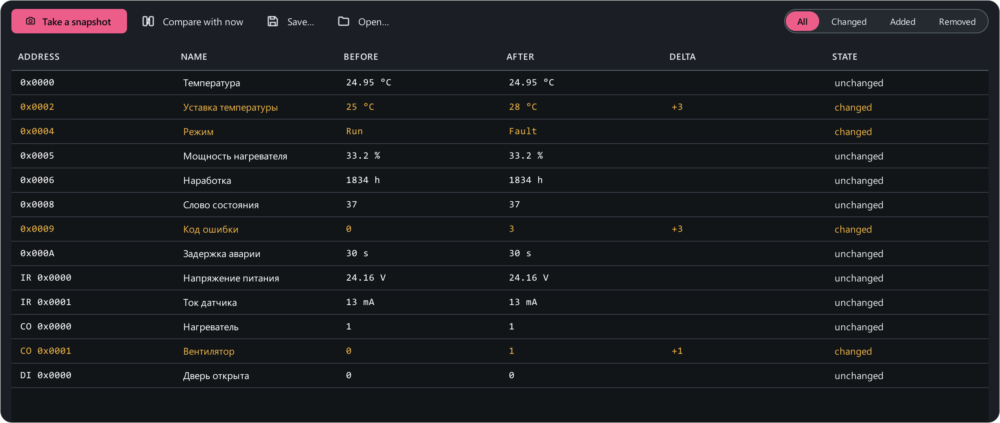

# Snapshots

**Snapshots** (++ctrl+7++) answer "what changed?". Remember every value,
change something on the device — from its front panel, the SCADA or another
program — and compare.

1. Connect and wait for the values to arrive.
2. **Take a snapshot** — the app remembers the current value of every map
   register.
3. Change something on the device.
4. **Compare with now** — the table shows **Before**, **After**, **Delta** and
   **State** for every register: changed, unchanged, added or removed (if the
   map changed between snapshots).

The **All / Changed / Added / Removed** filters keep what you need; the
summary at the top reads "Changed: 4 · added: 0 · removed: 0 · unchanged: 9".
Values are compared in engineering units — as the table shows them.

**Save…** writes the snapshot to an `.mbsnap` file, **Open…** loads it back —
so you can compare a device with what it was yesterday or on another site.
Typical uses: finding which register holds a parameter that changes from the
device's front panel; checking that settings survived a firmware update.
