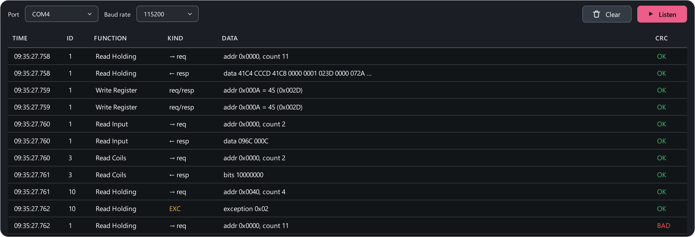

# Sniffer

The **Sniffer** (++ctrl+5++) listens to an RS-485 line and shows every frame
between **someone else's** master (a SCADA, PLC, HMI) and the devices. It
**never transmits a single byte** — the line works as usual.

## Hooking up

The sniffer needs **its own adapter**, wired to the same A/B pair in parallel
with the line. A port that this app is polling cannot be opened by the
sniffer: a port has exactly one owner.

1. Wire a second USB-to-RS-485 adapter to the line (A to A, B to B, GND to
   GND).
2. Open **Sniffer**, pick this adapter's **port** and the **baud rate** of
   the line. Parity and stop bits come from **Settings → Connection**.
3. Press **Listen**.

The baud rate must match the line: at another rate frames break up into junk
with CRC errors.

## What you see

| Column | Meaning |
|---|---|
| Time | When the frame arrived |
| ID | Device address |
| Function | Read Holding, Write Register… — see [function codes](../modbus/functions.md) |
| Kind | Request, response, exception or junk |
| Data | Decoding: address, count, values |
| CRC | OK or BAD |

Hover a row — the tooltip shows the whole frame in hex.

The app splits frames by the silences on the line (the 3.5-character rule),
checks the CRC and decodes functions 01–06, 08, 15, 16, 22, 23. Exceptions
are highlighted; a frame with a bad CRC is marked **BAD**.

## What it is good for

- **Learning a map without documentation:** which registers the SCADA reads
  and how often — so they exist and matter.
- **Finding out who is at fault:** the master sends no request, the device
  does not answer, or answers with an exception.
- **Spotting noise:** lots of BAD CRC — the problem is in the line
  (terminator, ground, shield), not in the software.
- **Checking yourself:** a second adapter on the same line shows ModbusReader's
  own traffic "from the outside".

The whole scenario: [Debugging a line](../examples/line-debugging.md).
