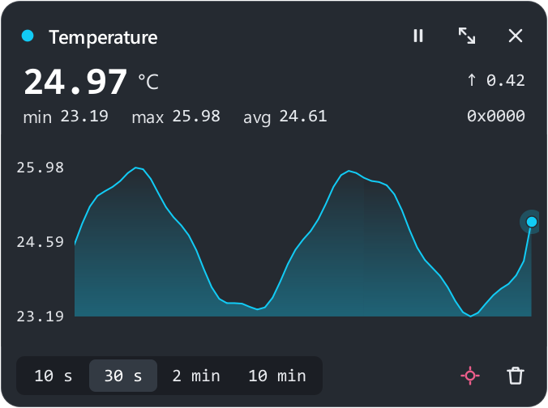
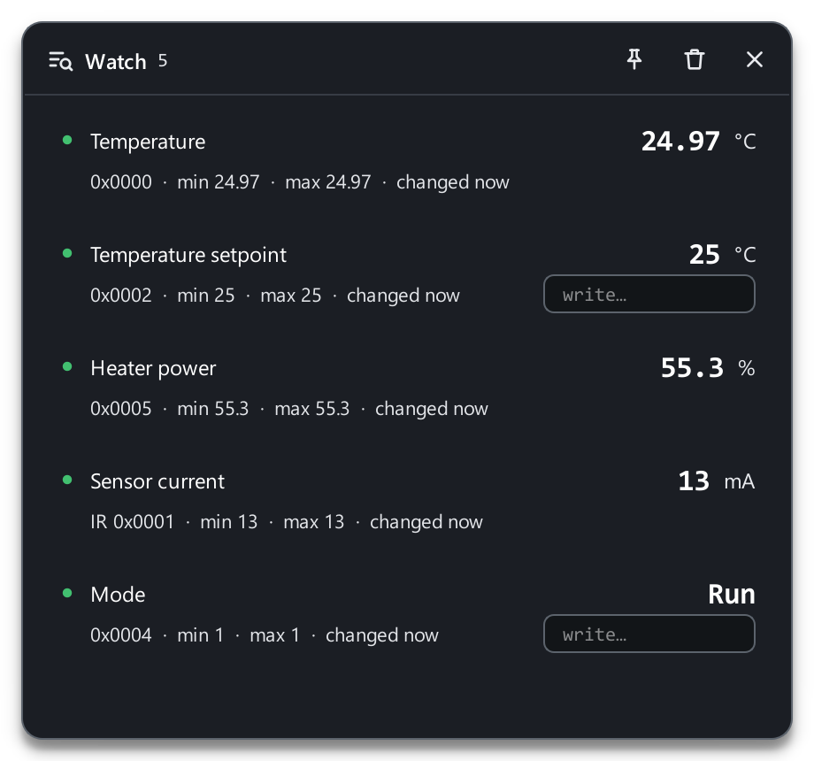

# Trends and watch

## Trends

Any register can go on a live chart: right-click a map row → **Add to live
chart**. Chart cards appear in the **Live Monitoring** panel on the right;
up to 8 at once.

{ width="420" }

On a card:

- big — the **current value** with its unit and the change over the window
  (arrow);
- **min / max / avg** over the visible window;
- the time window: **10 s · 30 s · 2 min · 10 min**;
- ⏸ **Pause** — stop scrolling to look at a stretch;
- ⤢ **Expand** (or double-click the chart) — full screen;
- ⌖ **Auto-fit Y** — fit the axis to the visible data;
- 🗑 **Clear** — wipe the collected history;
- ✕ — remove the chart.

Cards can be reordered by dragging. If the link drops, the line dims and the
card shows how long there has been no data.

**Settings → Graphs:** default time window, auto-fit for new charts, line
smoothing (turn it off on a slow PC with many charts), history buffer per
register and panel width.

The trend panel and the transaction log are shown and hidden with the
**Layout** button on the right of the window header (**Graph panel** and
**Transaction log**).

## The watch window { #watch }

**Watch** (++f6++) is a small floating window with the registers you pick.
It is visible from any page of the app and can stay **on top of all
windows** (the pin button) — next to a SCADA or the device documentation,
say.

{ width="380" }

- Add: right-click a map row or a dashboard widget → **Add to watch**.
- For every register you see the value, min / max since it was added and
  when it last changed.
- **Double-click Write** — type a new value and write it to the device
  (++enter++).
- Right-click a row: **Move up / Move down**, **Reset min/max**, **Remove
  from watch**.

Values in the window update while polling runs.
