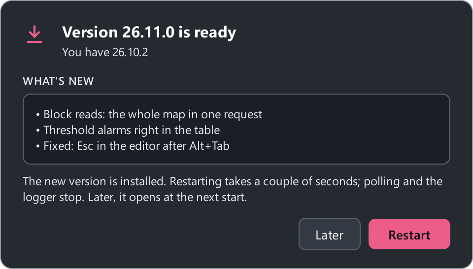

# Install

ModbusReader is free and needs no Python or other software: everything it
needs is inside. To talk to a device you need a USB-to-RS-485 (or RS-232)
adapter — see [Connect a device](connect.md).

## Windows

[:material-download: Download ModbusReader-Setup.exe](https://github.com/Mercurrial/ModbusReader/releases/latest/download/ModbusReader-Setup.exe){ .md-button .md-button--primary }

The link always points to the latest version. You need 64-bit Windows 10
(version 1809 or later) or Windows 11.

There are two builds — pick either:

| | Installer | Portable |
|---|:---:|:---:|
| File | `ModbusReader-Setup.exe` | `ModbusReader.exe` |
| Installs to | just for you (the default) or for all users — in `C:\Program Files` | any folder, a USB stick |
| Administrator rights | just you — no, all users — yes | not needed |
| Start menu and desktop shortcuts | ✓ | — |
| `.mbproj` opens on double-click | ✓ | — |
| Uninstall | Settings → Apps | delete the file |
| Settings stored in | `%APPDATA%\ModbusReader` | next to the exe |
| Updates | ✓ | ✓ |

The portable build and a build with a console window for diagnostics
(`ModbusReader_debug.exe`) are on the
[Releases](https://github.com/Mercurrial/ModbusReader/releases/latest) page.

### The "Windows protected your PC" warning { #smartscreen }

The app is not signed with a paid certificate yet, so SmartScreen shows a
blue window on first launch. Click **More info** → **Run anyway**. You only
do this once: updates are downloaded and verified by the app itself.

!!! tip "Check the file was not tampered with"
    The [Releases](https://github.com/Mercurrial/ModbusReader/releases/latest)
    page shows the SHA-256 of every file. Compare with
    `certutil -hashfile ModbusReader-Setup.exe SHA256`.

## Linux

The build is a single `ModbusReader-x86_64.AppImage` on the
[Releases](https://github.com/Mercurrial/ModbusReader/releases/latest) page.
It needs a 64-bit system with glibc 2.35 or newer: Ubuntu 22.04+, Debian 12+,
Fedora 36+ and the like.

```bash
chmod +x ModbusReader-x86_64.AppImage
./ModbusReader-x86_64.AppImage
```

To see serial ports (`/dev/ttyUSB0`, `/dev/ttyACM0`) your user must be in
the `dialout` group. Do it once, then log out and back in:

```bash
sudo usermod -aG dialout $USER
```

If Qt complains about the `xcb` platform at start-up, install
`libxcb-cursor0` (Debian, Ubuntu) or `xcb-util-cursor` (Fedora, Arch).
Settings live in `~/.config/ModbusReader`.

## macOS

`ModbusReader-macOS-arm64.zip` is for Apple Silicon Macs (M1 and later),
macOS 12+. Unzip it and move `ModbusReader.app` to Applications.

The build is not notarized by Apple, so macOS blocks the first launch. Open
**System Settings → Privacy & Security** and click **Open Anyway**. If macOS
says the app is "damaged", remove the quarantine flag:

```bash
xattr -dr com.apple.quarantine /Applications/ModbusReader.app
```

Adapter ports look like `/dev/cu.usbserial-…`. Settings live in
`~/Library/Application Support/ModbusReader`.

## Run from source

You need Python 3.10 or newer.

=== "Windows"

    ```bash
    git clone https://github.com/Mercurrial/ModbusReader.git
    cd ModbusReader
    python -m venv .venv
    .venv\Scripts\pip install -r requirements.txt
    .venv\Scripts\python main.py
    ```

=== "Linux / macOS"

    ```bash
    git clone https://github.com/Mercurrial/ModbusReader.git
    cd ModbusReader
    python3 -m venv .venv
    .venv/bin/pip install -r requirements.txt
    .venv/bin/python main.py
    ```

## Updates { #updates }

The app checks for a new version at start-up and every few hours.

**The installed app** downloads the update, verifies its SHA-256 checksum and
installs the new version in the background, next to the current one — your
work and the polling go on. When it is ready, an **Update to …** button
appears in the page menu: click it and the app restarts as the new version in
a couple of seconds (polling and logger recording stop meanwhile). If you do
not restart, the new version opens at the next start, and the old one removes
itself. When the app is installed for all users, Windows asks for permission,
so the app asks you once before installing.

**The portable version** shows what is new and updates after you press
**Update**: it downloads the new file, closes and opens again as the new
version. A version you do not want can be skipped with **Skip this version**.

On Linux and macOS the app tells you about a new version and opens the
release page — download the file by hand. Automatic checks can be turned
off: **Settings → General → Check for updates automatically**.

{ width="520" }

## Files the app writes

- `app_settings.json` — settings (location in the table above). Written
  atomically, with a `.bak` copy and recovery if it gets damaged.
- `modbusreader_errors.log` — same folder: tracebacks of unexpected errors.
  Attach it to a bug report.
- Downloaded updates — `%LOCALAPPDATA%\ModbusReader\updates`, removed after
  installing.
- The installed app keeps each version in its own `app-<version>` folder next
  to `ModbusReader.exe`, which opens the newest one. Old folders are removed at
  the next start.
- Your copy of the demo project — `Documents\ModbusReader`.

Next: the [quick start](quickstart.md).
