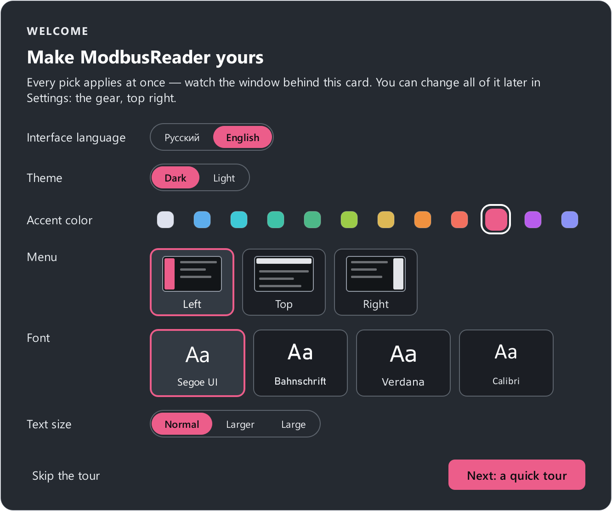
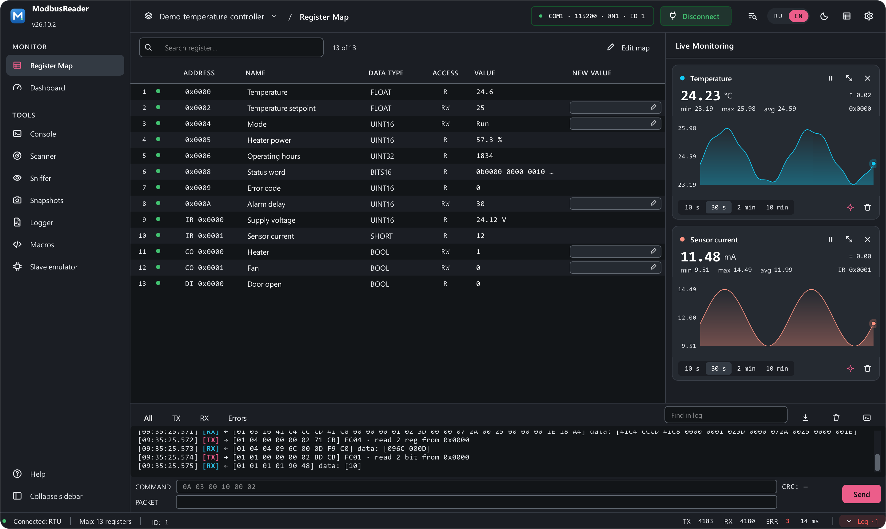

# Quick start

Five steps from the first launch to live values from a device.

## 1. Look at the demo project

On first launch the **demo project** opens straight away — a made-up
temperature controller with a 13-register map and a ready-made dashboard.
Over it a **Welcome** card offers the language, theme, accent colour, menu
position and font — every pick shows on the window at once — and then a short
tour of the interface. Reopen the tour any time with **Help** or ++f1++: on
every page it explains that page.

{ width="560" }

On the left is the page menu (it can sit on top or on the right instead):
**Monitor** first (the register map and the dashboard), then **Tools**. Top
right are the link settings, **Connect** and the settings gear. At the bottom
are the transaction log and the raw-frame line.

The demo project sits in the **Projects** folder next to the program — where
your own projects open and save too. You can also get back to it with **Demo
project** on the empty map screen.

## 2. Open or create a register map

The map describes the device registers: addresses, names, data types,
units. Without it the app has nothing to poll. Options:

- **Open project** (++ctrl+o++) — an `.mbproj` file holding the map, the
  link settings and the dashboards together.
- **Open map** (++ctrl+shift+o++) — a standalone `.json` with just the
  register list.
- **Import from a spreadsheet** — CSV or Excel from the device datasheet.
  See the [map from a datasheet](examples/datasheet-import.md) example.
- **Create map** — by hand in the [map editor](guide/map-editor.md).

## 3. Set the link parameters

Click the link settings in the header (`COM1 · 115200 · 8N1 · ID 1`) — the
[connection card](connect.md#card) opens. Pick the interface:

- **Serial port** — the adapter's port (`/dev/ttyUSB0` on Linux,
  `/dev/cu.usbserial-…` on macOS), **baud rate**, **parity**, **stop bits**
  and the **device address** (Slave ID, 1–247) — as configured in the device;
- **Modbus TCP** — the device's IP address, port (usually 502) and unit ID
  (usually 1);
- **RTU over TCP** — an RS-485 ↔ Ethernet converter in transparent mode.

Press **Test link** — the app asks the device one question and tells you in
words what happened; on a network it also finds the right unit ID and mode.

Every parameter must match the device, otherwise it simply does not
answer. If you don't know the device settings, find it with the
[scanner](guide/scanner.md). Adapters and wiring are covered in
[Connect a device](connect.md).

## 4. Connect

Press **Connect** (in the card or in the header) or ++f5++. The app opens the
port or the connection and starts polling every
register of the map in a loop (the period is **Settings → Connection → Poll
period**, 500 ms by default).

- A green dot next to a register — the value is fresh; amber — the device
  stopped answering this register ([more](guide/register-map.md#state)).
- Bottom right — line statistics: sent, received, errors, response time.
  Click for details.
- At the bottom — the transaction log: every frame in hex, decoded.

If no values appear, open the log and see [Troubleshooting](troubleshooting.md):
timeouts, CRC errors and exceptions are covered there.

## 5. Read and write

- **Write:** click the field with a pencil in the **New value** column (only
  registers that can be written have it), type a number and press ++enter++
  (or ++f2++ on the selected row).
- **Chart:** right-click a row → **Add to live chart**.
- **Watch:** right-click → **Add to watch**; the window is ++f6++.
- **Display:** right-click → **View as** — decimal, hexadecimal or binary.

Save everything as one file — **Save project** (++ctrl+s++). Next time the
app opens it by itself.

## No device at hand { #no-device }

The demo project has a made-up device of its own — **Demo** in the connection
card. Press **Connect** and the demo comes to life with no cable: the
temperature holds the setpoint, the heater power adjusts, now and then the
door opens. The device reacts to writes:

- raise the **setpoint** — the temperature follows;
- **Stop** mode or the **heater** switched off — it cools down;
- the **fan** — the heater needs more power;
- a door left open longer than the **alarm delay** puts the device into
  **Fault** with an error code; **Run** mode resets it.

Only the demo project has the simulation. To try your own map without a
device, use the emulator, no second computer needed:

1. On the [Slave emulator](guide/slave.md) page pick **Modbus TCP** and press
   **Start**.
2. In the connection card pick **Modbus TCP**, IP address `127.0.0.1` and the
   emulator's port — then **Connect**.
3. Change values in the emulator's table — the register map shows them.

Testing a master over a COM port, and testing a SCADA:
[Testing a SCADA with the emulator](examples/test-scada.md).

## Next

- [Modbus basics](modbus/index.md) — if 40001 addresses, byte order and
  function codes still sound mysterious.
- [User guide](guide/index.md) — every page of the app in order.
- [Examples](examples/index.md) — ready-made macros and scenarios.
