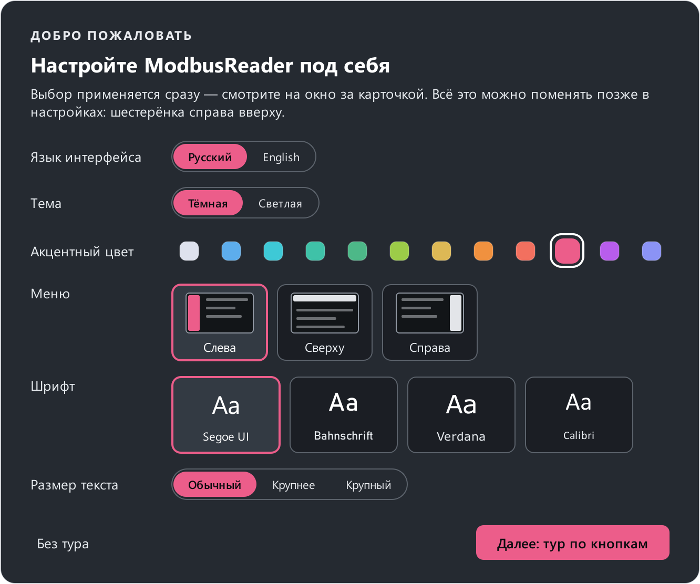

# Быстрый старт

Пять шагов: от первого запуска до живых значений с прибора.

## 1. Посмотрите демо-проект

При первом запуске сразу открывается **демо-проект** — придуманный
термоконтроллер с картой из 13 регистров и готовым пультом на дашборде.
Поверх него карточка **«Добро пожаловать»** предложит выбрать язык, тему,
акцентный цвет, расположение меню и шрифт — выбор сразу виден на окне, —
а затем короткий тур по интерфейсу. Тур можно открыть снова кнопкой
**«Справка»** или клавишей ++f1++ — на каждом экране он рассказывает про
этот экран.

{ width="560" }

Слева — меню экранов (его можно поставить сверху или справа): сначала
**«Мониторинг»** (карта регистров и дашборд), дальше **«Инструменты»**.
Сверху справа — параметры связи, кнопка **«Подключить»** и шестерёнка
настроек. Внизу — журнал обмена и строка отправки сырых кадров.

Вернуться к демо-проекту можно кнопкой **«Демо-проект»** на пустом экране
карты: программа положит его копию в `Документы\ModbusReader`.

## 2. Откройте или создайте карту регистров

Карта описывает регистры прибора: адреса, имена, типы данных, единицы. Без
неё программе нечего опрашивать. Варианты:

- **Открыть проект** (++ctrl+o++) — файл `.mbproj`, в нём карта, параметры
  связи и дашборды вместе.
- **Открыть карту** (++ctrl+shift+o++) — отдельный файл `.json` только со
  списком регистров.
- **Импорт из таблицы** — CSV или Excel из паспорта прибора. Подробно — в
  примере [Карта из паспорта прибора](examples/datasheet-import.md).
- **Создать карту** — вручную в [редакторе карты](guide/map-editor.md).

## 3. Задайте параметры связи

Щёлкните по параметрам связи в шапке (`COM1 · 115200 · 8N1 · ID 1`) —
откроется [карточка подключения](connect.md#card). Выберите интерфейс:

- **COM-порт** — порт адаптера (на Linux `/dev/ttyUSB0`, на macOS
  `/dev/cu.usbserial-…`), **скорость**, **чётность**, **стоп-биты** и
  **адрес прибора** (Slave ID, 1–247) — как в настройках прибора;
- **Modbus TCP** — IP-адрес прибора, порт (обычно 502) и Unit ID (обычно 1);
- **RTU по TCP** — преобразователь RS-485 ↔ Ethernet в прозрачном режиме.

Нажмите **«Проверить связь»** — программа задаст прибору один вопрос и
скажет словами, что получилось, а для сети сама подберёт Unit ID и режим.

Все параметры должны совпадать с прибором, иначе он просто не ответит. Если
настройки прибора неизвестны — найдите его [сканером](guide/scanner.md).
Про адаптер и проводку — в разделе [Подключение к прибору](connect.md).

## 4. Подключитесь

Нажмите **«Подключить»** (в карточке или в шапке) или ++f5++. Программа
откроет порт или соединение и начнёт
циклически опрашивать все регистры карты (период — **Настройки →
Подключение → Период опроса**, по умолчанию 500 мс).

- Зелёная точка у регистра — значение свежее, жёлтая — прибор перестал
  отвечать по этому регистру ([подробнее](guide/register-map.md#state)).
- В правом нижнем углу — статистика линии: отправлено, получено, ошибки,
  время ответа. Щелчок по ней открывает подробности.
- Внизу — журнал обмена: каждый кадр в шестнадцатеричном виде с разбором.

Если значения не появляются — откройте журнал и раздел
[Решение проблем](troubleshooting.md): там разобраны таймауты, ошибки CRC и
исключения.

## 5. Читайте и пишите

- **Запись:** щёлкните по полю с карандашом в колонке **«Новое значение»**
  (оно есть только у регистров, которые можно записать), введите число и
  нажмите ++enter++ (или ++f2++ на выделенной строке).
- **График:** правый щелчок по строке → **«Добавить на график»**.
- **Наблюдение:** правый щелчок → **«Добавить в наблюдение»**, окно — ++f6++.
- **Вид значения:** правый щелчок → **«Показывать как»** — десятичное,
  шестнадцатеричное или двоичное.

Сохраните всё одним файлом — **Сохранить проект** (++ctrl+s++). В следующий
раз программа откроет его сама.

## Без прибора под рукой

Демо-карту можно «оживить» без железа и без второго компьютера:

1. На экране [Эмулятор (Slave)](guide/slave.md) выберите **Modbus TCP** и
   нажмите **«Запустить»**.
2. В карточке подключения выберите **Modbus TCP**, IP-адрес `127.0.0.1` и
   тот же порт, что у эмулятора, — и **«Подключить»**.
3. Меняйте значения в таблице эмулятора — карта регистров покажет их.

Проверка мастера по COM-порту и проверка SCADA — в примере
[Проверка SCADA эмулятором](examples/test-scada.md).

## Дальше

- [Основы Modbus](modbus/index.md) — если адреса 40001, порядок байт и коды
  функций пока звучат загадочно.
- [Руководство](guide/index.md) — все экраны программы по порядку.
- [Примеры](examples/index.md) — готовые макросы и сценарии.
